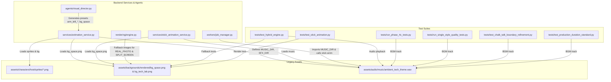

# Asset Library Audit & Redesign Strategy

**Document Status:** Pending User Review & Approval  
**Project Root:** `D:\AI Arts\AI\`  
**Target Date:** 2026-11-10  
**Authors:** AI YouTube Shorts Studio Architecture Team  

---

## 1. Executive Summary & Objective

The existing application successfully produces videos, but the visual quality of the legacy characters and background plates in the `assets/` directory no longer meets the standards required for a professional AI YouTube Shorts Studio. Originally authored as quick placeholders during initial proof-of-concept testing, these assets suffer from:
1. **Rigid, dated vector-puppet aesthetics**: Unnatural joint overlaps, limited facial expressions, and rudimentary gradient fills.
2. **Incompatibility with the four approved video styles**: They clash with *Pop Info* (warm pastel cartoon), *Data Story* (authoritative dark slate journalism), *Chalk Talk* (hand-drawn blackboard chalk), and *Creator Motion Graphics* (high-energy kinetic 3D yaw typography).
3. **Severe lack of topical variety**: Only one sci-fi host and two dark space/lab backgrounds exist, forcing completely unrelated educational topics (e.g., economics, psychology, everyday life) to render against sci-fi nebulae.

This document establishes a **comprehensive audit** of all existing assets and dependencies, presents a **non-destructive archival plan** moving legacy files into `archive/legacy_assets/`, and details a **modern, modular asset architecture** designed for production-standard YouTube Shorts (1080×1920, 9:16 vertical video).

> [!IMPORTANT]
> **Strict Governance Gate:** No files will be moved, modified, or generated until the user reviews and explicitly approves this audit and strategy document. The four reference HTML implementations in `docs/reference_styles/*.html` remain strictly immutable.

---

## 2. Comprehensive Audit of Existing Assets (`assets/`)

### 2.1 Complete Asset Inventory

The `assets/` directory currently contains 33 files across 5 main subdirectories, totaling **12.5 MB** (with 11.2 MB accounted for by the synthesized audio track):

| Relative Path | Format | Resolution | File Size | Category | Current Usage / Status |
| :--- | :---: | :---: | :---: | :---: | :--- |
| `assets/characters/host/head.svg` | SVG | 400×400 | 2.1 KB | Character Part | Base human head with gradient hair and ears |
| `assets/characters/host/torso.svg` | SVG | 600×600 | 1.9 KB | Character Part | Torso with dark navy blazer and blue undershirt |
| `assets/characters/host/arm_left_idle.svg` | SVG | 400×800 | 0.9 KB | Character Part | Hanging left arm (idle posture) |
| `assets/characters/host/arm_left_present.svg` | SVG | 400×800 | 1.0 KB | Character Part | Raised left arm (presenting posture) |
| `assets/characters/host/arm_right_idle.svg` | SVG | 400×800 | 0.9 KB | Character Part | Hanging right arm (idle posture) |
| `assets/characters/host/arm_right_think.svg` | SVG | 400×800 | 1.1 KB | Character Part | Bent right arm with hand to chin |
| `assets/characters/host/eyebrows_curious.svg` | SVG | 400×100 | 0.4 KB | Character Part | Asymmetrical raised eyebrow |
| `assets/characters/host/eyebrows_neutral.svg` | SVG | 400×100 | 0.4 KB | Character Part | Flat neutral resting eyebrows |
| `assets/characters/host/eyes_blink.svg` | SVG | 400×200 | 0.4 KB | Character Part | Closed eyelid lines for blink cycle |
| `assets/characters/host/eyes_open.svg` | SVG | 400×200 | 1.5 KB | Character Part | Open eyes with blue pupils and highlights |
| `assets/characters/host/mouth_closed.svg` | SVG | 400×200 | 0.2 KB | Character Part | Resting closed mouth line |
| `assets/characters/host/mouth_open_ae.svg` | SVG | 400×200 | 0.4 KB | Character Part | Open mouth phoneme (A/E sounds) |
| `assets/characters/host/mouth_open_o.svg` | SVG | 400×200 | 0.3 KB | Character Part | Rounded mouth phoneme (O/U sounds) |
| `assets/characters/host/mouth_smile.svg` | SVG | 400×200 | 0.3 KB | Character Part | Closed smile expression |
| `assets/characters/host/sprites/*.png` (14 files) | PNG | 600×120–1200 | 338 KB (tot) | Raster Sprites | Pre-rendered raster counterparts of above SVGs |
| `assets/backgrounds/bg_space.svg` | SVG | 1080×1920 | 3.3 KB | Background Plate | Dark blue/black space plate with cyan nebula blobs |
| `assets/backgrounds/bg_tech_lab.svg` | SVG | 1080×1920 | 1.8 KB | Background Plate | Dark charcoal lab plate with radial cyan light |
| `assets/backgrounds/rendered/bg_space.png` | PNG | 1080×1920 | 307.2 KB | Background Plate | Rendered 1080×1920 RGBA raster of space background |
| `assets/backgrounds/rendered/bg_tech_lab.png` | PNG | 1080×1920 | 267.8 KB | Background Plate | Rendered 1080×1920 RGBA raster of tech lab |
| `assets/icons/` | Dir | — | 0 B | Iconography | **Empty directory**; no reusable UI icons or props |
| `assets/audio/generate_assets.py` | Python | — | 4.6 KB | Generator | Python synthesis script using `wave`, `math`, `struct` |
| `assets/audio/music/ambient_tech_theme.wav` | WAV | 44.1kHz 16b | 11.2 MB | BGM | 65.0s ambient lo-fi synth chord progression (Dm9-Bb-F-C) |
| `assets/audio/sfx/chime_pop.wav` | WAV | 44.1kHz 16b | 155.1 KB | SFX | 0.9s synthetic chime pop |
| `assets/audio/sfx/whoosh_transition.wav` | WAV | 44.1kHz 16b | 137.9 KB | SFX | 0.8s synthetic cinematic frequency sweep whoosh |
| `assets/media_library/images/.gitkeep` | Gitkeep | — | 6 B | Media Acquisition | Target for downloaded raw images (Stage 2) |
| `assets/media_library/portrait/.gitkeep` | Gitkeep | — | 6 B | Media Acquisition | Target for processed 1080×1920 portrait images |
| `assets/media_library/manifests/.gitkeep` | Gitkeep | — | 6 B | Media Acquisition | Target for JSON attribution manifests |

---

## 3. Codebase Dependency & Reference Mapping

Every reference to these assets across the entire codebase has been cataloged. Any asset movement or restructuring must account for these exact call sites:



### Detailed Call Sites:

1. **`backend/app/services/animation_service.py`**:
   - Lines 25–28: Defines `SPRITES_DIR = os.path.join(BASE_DIR, "assets", "characters", "host", "sprites")`, `BG_DIR = os.path.join(BASE_DIR, "assets", "backgrounds", "rendered")`, `SFX_DIR`, and `MUSIC_DIR`.
   - Lines 43–49: Hardcoded list of 14 sprite file basenames (`head`, `torso`, `arm_left_idle`, etc.).
   - Line 255: `bg_img = Image.open(os.path.join(BG_DIR, "bg_space.png")).convert("RGBA")`.
2. **`backend/app/services/stick_animation_service.py`**:
   - Line 23: `MUSIC_DIR = os.path.join(BASE_DIR, "assets", "audio", "music")`.
   - Line 342: `bg_img = Image.open(os.path.join(BASE_DIR, "assets", "backgrounds", "rendered", "bg_space.png")).convert("RGBA")`.
3. **`backend/app/agents/visual_director.py`**:
   - Lines 37–45: `scene_presets` table references `"arm_left_idle"`, `"arm_right_think"`, `"eyebrows_curious"`, `"eyebrows_surprised"`, `"char_x": 40`, `"char_y": 760`.
   - Line 66: `"background": "bg_space"`.
4. **`backend/app/rendering/engine.py`**:
   - Line 88: Fallback image for `VisualModality.REAL_PHOTO` / `CINEMATIC_STILL` when no image path is passed: `os.path.join(self.workspace_root, "assets", "backgrounds", "rendered", "bg_space.png")`.
   - Lines 100–101: Fallback images for `VisualModality.SPLIT_SCREEN`: defaults top image to `bg_space.png` and bottom image to `bg_tech_lab.png`.
5. **`backend/app/workers/job_manager.py`**:
   - Line 26: `from app.services.animation_service import render_animation, MUSIC_DIR`.
   - Line 232: `music_path = os.path.join(MUSIC_DIR, "ambient_tech_theme.wav")`.
   - Line 234: Invokes `render_stick_animation(...)` in Stage 5.
6. **Test Suites**:
   - `backend/tests/test_stick_animation.py`: line 65 loads `bg_space.png`.
   - `backend/tests/test_hybrid_engine.py`: lines 144, 157, 192, 193 reference `ambient_tech_theme.wav`, `bg_space.png`, `bg_tech_lab.png`.
   - `backend/tests/run_phase_4c_tests.py`, `run_single_style_quality_tests.py`, `test_chalk_talk_boundary_refinement.py`, `test_production_duration_standard.py`: all use `ambient_tech_theme.wav` as test audio.
7. **Frontend UI Mock (`frontend/src/App.tsx`)**:
   - Lines 425–450: Hardcoded sample storyboard labels describing poses (`Curious Eyebrows • Thinking Chin Pose`, `Presenting Arm Gesture • Talking Phonemes`).

---

## 4. Visual Consistency & Style Suitability Evaluation

A critical evaluation of how well the existing assets align with our four production visual styles:

```
+---------------------------------------------------------------------------------------------------+
|                                 VISUAL SUITABILITY SCORECARD                                      |
+--------------------------+-----------------------+-----------------------+------------------------+
| Style                    | Character Fit (0-10)  | Background Fit (0-10) | Overall Verdict        |
+--------------------------+-----------------------+-----------------------+------------------------+
| 1. Pop Info              | 2/10 (Wrong genre)    | 1/10 (Dark sci-fi)    | UNUSABLE               |
| 2. Data Story            | 1/10 (Undermines QC)  | 3/10 (Too noisy)      | UNUSABLE               |
| 3. Chalk Talk            | 0/10 (Breaks chalk fx)| 0/10 (Not chalkboard) | UNUSABLE               |
| 4. Creator Motion Graph. | 3/10 (Outdated flash) | 4/10 (Generic nebula) | UNUSABLE               |
+--------------------------+-----------------------+-----------------------+------------------------+
```

### 4.1 Style 1: Pop Info
- **Aesthetic Definition:** Warm, friendly, approachable flat-vector educational cartoon (Vox, Kurzgesagt, grocery retail explainer). Palette: Cream (`#F5EFEB`), Deep Teal (`#2F6F73`), Coral (`#E85D4A`), Mustard Gold (`#ECA82C`), Charcoal Ink (`#1D262B`). Typography: Fredoka, DM Sans.
- **Evaluation of Existing Assets:**
  - *Character:* The legacy host wears a dark futuristic jacket with harsh gradients and has an angular, rigid puppet structure. In contrast, Pop Info requires rounded geometry, friendly organic silhouettes (like the shopper and milk mascot in `pop_info.html`), soft pastel clothing, and clean flat coloring without heavy dark gradients.
  - *Backgrounds:* `bg_space` and `bg_tech_lab` are cold, cybernetic, and black/cyan. Placing a Pop Info educational scene against a dark space nebula looks jarring and nonsensical. Pop Info demands warm cream/pastel interior cards, grocery aisle isometric rooms, soft floor shadows, and subtle warm vignettes.

### 4.2 Style 2: Data Story
- **Aesthetic Definition:** Authoritative, clean financial and statistical data journalism (The Economist, Financial Times, Bloomberg, Vox Data). Palette: Deep Slate Ink (`#0F141C`), Metric Emerald (`#10B981`), Accent Electric Blue (`#3B82F6`), Soft Grey (`#94A3B8`). Typography: Archivo, IBM Plex Mono.
- **Evaluation of Existing Assets:**
  - *Character:* Cartoon puppets do not belong in serious data journalism. A cartoon character host distracts from charts and diminishes factual authority. In Data Story, human presence should be strictly limited to subtle monochrome silhouettes, editorial icon stamps, or real-world photojournalist imagery (sourced via Stage 2 Media Acquisition).
  - *Backgrounds:* The space/lab backgrounds have chaotic radial gradients and star specs that interfere with data legibility. Data Story requires subtle isometric coordinate grids (`rgba(255,255,255,0.04)`), clean slate plates, and structured metric card containers.

### 4.3 Style 3: Chalk Talk
- **Aesthetic Definition:** Hand-drawn blackboard classroom lecture (3Blue1Brown, Khan Academy, Veritasium). Palette: Deep Slate Blackboard (`#24392F`), Oak Wood Frame (`#3A2312`), Chalk White (`#F8F9FA`), Chalk Yellow (`#FCD34D`), Chalk Sky Blue (`#7DD3FC`). Typography: Cabin Sketch, Kalam.
- **Evaluation of Existing Assets:**
  - *Character:* Pasting a full-color glossy vector character onto a blackboard immediately destroys the physical chalkboard illusion. Chalk Talk requires hand-drawn chalk stick figures drawn with chalk dust texture, stroke jitter, and imperfect chalk outlines.
  - *Backgrounds:* Digital cyan gradients completely contradict a physical slate blackboard. Chalk Talk requires textured slate backdrops with subtle chalk smudges, wood framing, and chalk particle dust.

### 4.4 Style 4: Creator Motion Graphics
- **Aesthetic Definition:** Modern high-velocity creator video (Ali Abdaal, Johnny Harris, Iman Gadzhi). Palette: Studio Black (`#0B0B0D`), Kinetic Yellow (`#FFE600`), Vivid Red (`#FF3366`), Cyber Cyan (`#00F0FF`). Typography: Anton, Inter, Instrument Serif. Elements: 3D yaw containers, kinetic text slams, highlighter swipes, timeline scissors, device mockups.
- **Evaluation of Existing Assets:**
  - *Character:* The 2010s-era Flash puppet character looks cheap and dated against ultra-modern motion graphics. Creator style requires modern visual hooks: floating avatar pill circles, real-world cutout photos, UI push notification popups, and device frame overlays.
  - *Backgrounds:* The static radial space gradient lacks the sophisticated lighting, subtle noise, and dynamic lighting sweeps demanded by modern creator motion graphics.

---

## 5. Outdated Asset Archival Plan

To maintain complete historical preservation without cluttering the active production library, all legacy character and background assets will be safely relocated:

### 5.1 Archival Mapping

```
Existing Path                              -> Archive Path
assets/characters/host/*                   -> archive/legacy_assets/characters/host/*
assets/characters/host/sprites/*           -> archive/legacy_assets/characters/host/sprites/*
assets/backgrounds/bg_space.svg            -> archive/legacy_assets/backgrounds/bg_space.svg
assets/backgrounds/bg_tech_lab.svg          -> archive/legacy_assets/backgrounds/bg_tech_lab.svg
assets/backgrounds/rendered/bg_space.png    -> archive/legacy_assets/backgrounds/rendered/bg_space.png
assets/backgrounds/rendered/bg_tech_lab.png -> archive/legacy_assets/backgrounds/rendered/bg_tech_lab.png
```

### 5.2 What Remains in `assets/` (Active Assets)
1. `assets/audio/`: Retained intact. `music/ambient_tech_theme.wav` and the SFX files are actively used by test suites and background rendering. They will be supplemented, not removed.
2. `assets/media_library/`: Retained intact. This is the newly established home for openly licensed media acquired by Stage 2.

### 5.3 Safe Phased Migration (Zero Downtime Guarantee)
1. **Phase A (Approval)**: Submit this document; await user approval.
2. **Phase B (Generation)**: Generate the complete new modular asset library directly into newly organized folders (`assets/characters/`, `assets/backgrounds/`, `assets/props/`, `assets/badges/`).
3. **Phase C (Reference Redirection)**: Update references in `engine.py`, `animation_service.py`, `visual_director.py`, and test suites to point to the new high-quality assets.
4. **Phase D (Archival Move)**: Move legacy assets to `archive/legacy_assets/` while strictly preserving directory structures. Run the complete test suite (`pytest`) to verify zero regressions.

---

## 6. Proposed New Visual Asset Architecture

The redesigned asset library is structured specifically for production YouTube Shorts: 1080×1920 (9:16 vertical), modular, style-aware, and character-consistent.

```
assets/
├── audio/
│   ├── music/
│   │   ├── ambient_tech_theme.wav          # Existing fallback
│   │   ├── pop_playful_acoustic.wav         # Upbeat acoustic/marimba for Pop Info
│   │   ├── editorial_pulse.wav              # Minimal techno/subtle pulse for Data Story
│   │   └── cinematic_drive.wav              # High-energy bass & synth for Creator Style
│   └── sfx/
│       ├── chime_pop.wav                    # Existing
│       ├── whoosh_transition.wav           # Existing
│       ├── chalk_draw.wav                   # Chalk scratch SFX for Chalk Talk
│       ├── marker_swipe.wav                 # Highlighter swipe SFX
│       ├── camera_shutter.wav               # Photo snapshot SFX
│       └── ui_pop.wav                       # Notification pop SFX
│
├── backgrounds/                             # High-res 1080x1920 (9:16) Plates
│   ├── pop_info/
│   │   ├── bg_warm_cream.png                # Warm cream pastel with subtle room shadow
│   │   ├── bg_supermarket_aisle.png         # Stylized isometric retail aisle
│   │   └── bg_kitchen_counter.png           # Friendly domestic context plate
│   ├── data_story/
│   │   ├── bg_dark_slate_grid.png           # Deep slate (#0F141C) with isometric coordinates
│   │   ├── bg_editorial_dots.png            # Financial Times/Bloomberg style dot matrix
│   │   └── bg_chart_board.png               # Minimal data stage container
│   ├── chalk_talk/
│   │   ├── bg_slate_blackboard.png          # High-res textured chalkboard with oak frame
│   │   └── bg_deep_green_board.png          # Classic dark green schoolhouse slate
│   └── creator/
│       ├── bg_studio_black.png              # Deep studio dark with soft top spotlight
│       ├── bg_neon_ambient.png              # Subtle dual-tint ambient rim glow
│       └── bg_device_stage.png              # Minimal desktop workspace backdrop
│
├── characters/                              # Multi-Style Modular Character Rigs
│   ├── pop_host/                            # "Alex" - Warm, expressive everyday guide
│   │   ├── base/                            # Consistent anatomical identity (hair, face, skin)
│   │   │   ├── head_neutral.svg / .png
│   │   │   ├── hair_signature.svg / .png    # Locked chestnut swept hair
│   │   │   └── eyes_matrix.svg / .png       # Open, Blink, Looking Up, Squint
│   │   ├── expressions/                     # Facial expressions
│   │   │   ├── exp_neutral.png
│   │   │   ├── exp_curious.png
│   │   │   ├── exp_shocked.png
│   │   │   ├── exp_explaining.png
│   │   │   └── exp_smiling.png
│   │   ├── poses/                           # Upper-body production poses (1080-width scale)
│   │   │   ├── pose_idle_welcoming.png      # Relaxed open arms
│   │   │   ├── pose_thinking_chin.png       # Hand to chin, curious tilt
│   │   │   ├── pose_presenting_left.png     # Left hand gesturing to graphic card
│   │   │   ├── pose_presenting_right.png    # Right hand gesturing
│   │   │   ├── pose_shocked_hands.png       # Hands to cheeks, wide eyes
│   │   │   └── pose_pointing_up.png         # Index finger raised ("Did you know?")
│   │   └── outfits/
│   │       ├── teal_coat.png                # Iconic Pop Info teal trench & coral scarf
│   │       └── casual_hoodie.png            # Modern approachable educator hoodie
│   │
│   ├── chalk_figures/                       # Hand-drawn chalk lecturer figures
│   │   ├── chalk_teacher_pointing.png       # Pure chalk-stroke figure pointing to board
│   │   ├── chalk_student_thinking.png       # Chalk stick figure scratching head
│   │   └── chalk_crowd_silhouettes.png      # Chalk comparison group
│   │
│   └── silhouettes/                         # Editorial data silhouettes
│       ├── human_scale_monochrome.png       # Minimalist silhouette for size comparisons
│       └── consumer_avatar_stamp.png        # Icon stamp for per-capita data cards
│
├── props/                                   # Reusable Storytelling Props (SVG + PNG)
│   ├── pop_info/
│   │   ├── milk_carton_mascot.png           # Smiling milk carton prop
│   │   ├── grocery_basket.png               # Shopping basket with produce
│   │   ├── question_cloud.png               # Thought bubble with question mark
│   │   ├── lightbulb_idea.png               # Popping yellow idea lightbulb
│   │   └── alarm_clock.png                  # Vibrating comic clock
│   ├── data_story/
│   │   ├── currency_icons.png               # USD, EUR, GBP, JPY badges
│   │   ├── trend_arrows.png                 # Up/Down surge indicator arrows
│   │   └── globe_wireframe.png              # Isometric wireframe globe
│   ├── chalk_talk/
│   │   ├── chalk_stick_white.png            # Realistic angled chalk stick cursor
│   │   ├── felt_eraser_dust.png             # Felt eraser with particle smudge
│   │   ├── chalk_circle_callout.png         # Rough hand-drawn chalk circle
│   │   └── chalk_underline_wiggle.png       # Rough hand-drawn chalk underline
│   └── creator/
│       ├── device_iphone_mockup.png         # 3D tilted iPhone 16 frame
│       ├── ui_notification_bubble.png       # iOS / YouTube style notification banner
│       ├── timeline_scissors.png            # Sleek gold/metal scissor cutout
│       ├── verified_badge.png               # Blue YouTube/Twitter checkmark
│       └── highlighter_stroke.png           # Textured yellow marker swipe
│
└── media_library/                           # Stage 2 Openly Licensed Media (NASA, Wiki, etc.)
    ├── images/                              # Raw downloaded CC-licensed media
    ├── portrait/                            # Cropped/blurred 1080x1920 9:16 vertical images
    └── manifests/                           # AttributionManifest JSON files
```

---

## 7. Character Consistency Architecture

To prevent the common AI issue where characters look like entirely different people between scenes or videos, we establish a **Locked Identity Specification**:

### 7.1 Locked Identity: "Alex" (Pop Info & General Educational Host)
1. **Facial Model**: Defined proportions with locked aspect ratio (1.0 : 1.15 head ratio).
2. **Signature Palette**:
   - Skin: `#F8D7B8` (highlight `#FFEADB`, shadow `#E8B896`)
   - Hair: `#2A221E` (Dark espresso brown, swept right with single curl)
   - Eyes: `#1D262B` (Charcoal ink with dual round highlights)
   - Signature Coat: `#2F6F73` (Deep Teal) with `#E85D4A` (Coral accent collar)
3. **Layered Anchor Points**:
   - `Head Origin`: `(x: 540, y: 520)` on 1080×1920 canvas
   - `Eye Level`: `Head Origin + (0, 0)`
   - `Mouth Level`: `Head Origin + (0, +75)`
   - `Shoulder Joint Left`: `Head Origin + (-130, +160)`
   - `Shoulder Joint Right`: `Head Origin + (+130, +160)`
4. **Export Standard**: All poses exported at native 1080-width scale (transparent RGBA PNG at 300 DPI, plus master vector SVG). Any scene can hot-swap poses (`pose_idle_welcoming` -> `pose_thinking_chin`) without repositioning the character's core anchor.

---

## 8. Integration with Dual-Engine Rendering Pipeline

The new assets integrate directly into both engines:

1. **Python Canvas Engine (`photo_scene.py`, `split_screen.py`)**:
   - When no custom topic photograph is acquired, the engine pulls default backdrops from `assets/backgrounds/{style}/` instead of the legacy `bg_space.png`.
   - The split-screen renderer uses styled container dividers and badges from `assets/props/`.
2. **Headless Chromium Canvas Engine (Style Adapters)**:
   - Adapters receive asset paths via the storyboard parameters:
     ```json
     {
       "style": "pop_info",
       "character": {
         "id": "alex",
         "pose": "pose_thinking_chin",
         "expression": "exp_curious"
       },
       "background": "bg_supermarket_aisle",
       "prop": "milk_carton_mascot"
     }
     ```
   - In `pop_info/adapter.html`, `drawShopper` is upgraded to render the modular `Alex` character or use pre-composited high-res transparent sprites with smooth procedural breathing sway.
   - In `data_story/adapter.html`, real-world media from `assets/media_library/portrait/` is dynamically mounted into the editorial cards.
   - In `chalk_talk/adapter.html`, chalk stick figures from `assets/characters/chalk_figures/` are rendered with chalk blending modes (`destination-over`, chalk jitter).
   - In `creator_motion_graphics/adapter.html`, device frames from `assets/props/creator/device_iphone_mockup.png` are loaded onto 3D yaw planes.

---

## 9. Implementation Roadmap & Quality Gates

```
+---------------------------------------------------------------------------------------------------+
|                                     IMPLEMENTATION TIMELINE                                       |
+------+-------------------------------------------+--------------------------------+---------------+
| Step | Action Description                        | Target Location                | Approval Gate |
+------+-------------------------------------------+--------------------------------+---------------+
| 1    | Asset Audit & Redesign Strategy Review    | docs/ASSET_..._STRATEGY.md     | CURRENT GATE  |
| 2    | Generate Modular Vector Asset Library     | assets/{characters,bg,props}/  | User Review   |
| 3    | Update Engine & Storyboard References    | backend/app/{rendering,agents} | Automated QC  |
| 4    | Archive Outdated Assets                   | archive/legacy_assets/         | Verification  |
| 5    | Render Multi-Style Verification Video    | media/video/asset_showcase.mp4 | Final Signoff |
+------+-------------------------------------------+--------------------------------+---------------+
```

### Verification Criteria for Implementation:
- [ ] No permanent deletion of any legacy asset.
- [ ] Complete directory tree preserved under `archive/legacy_assets/`.
- [ ] Zero modifications to the four reference HTML files (`docs/reference_styles/*.html`).
- [ ] All new backgrounds render cleanly at 1080×1920 (9:16) with no distortion or pixelation.
- [ ] Consistent character identity maintained across all poses and expressions.
- [ ] All existing automated tests (`pytest`) pass with zero regressions.

---

## 10. Conclusion & Request for Approval

This audit confirms that the legacy assets are technically and stylistically obsolete. The proposed modular architecture provides a permanent, professional foundation tailored to our four approved video styles while maintaining zero risk to existing functionality through non-destructive archival and strict quality gates.

**Awaiting user approval before proceeding to Step 2 (Asset Generation & Implementation).**
