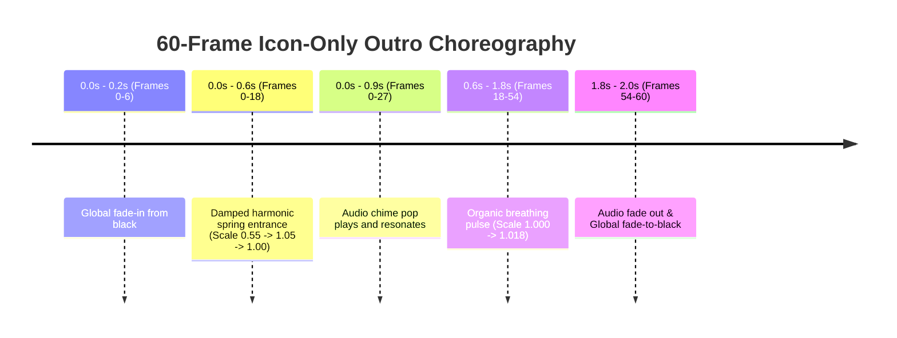

# CrazzyDocs Branded Outro Final Specification (Icon-Only)

## 1. Executive Summary

Stage 3.1 replaces the cluttered prototype outro with a minimalist, broadcast-grade **Icon-Only** outro.

The previous design featured horizontal banner artwork, text headlines ("CRAZZYDOCS"), taglines ("CURIOUS DAILY INSIGHTS"), and a subscribe button ("SUBSCRIBE FOR MORE"). In mobile vertical video, this text-heavy layout competed with YouTube Shorts native UI elements and created visual clutter.

The new specification standardizes on **pure visual minimalism**: exactly 2.0 seconds displaying only the circular CrazzyDocs channel icon with subtle kinetic entrance easing, breathing pulse, and an audio chime.

---

## 2. Technical Specifications

| Parameter | Specification | Notes |
| :--- | :--- | :--- |
| **Duration** | **Exactly 2.000 seconds** | 60 frames at 30.0 FPS constant framerate |
| **Resolution** | **1080 $\times$ 1920 pixels** | 9:16 vertical portrait format |
| **Frame Rate** | **Constant 30.0 FPS** | Timescale 30000/1000 |
| **Color Space** | `yuv420p` | Full mobile compatibility |
| **Video Codec** | `libx264`, CRF 18, Preset Fast | Master fidelity |
| **Audio Codec** | AAC, 320 kbps, 48000 Hz, Stereo | Synchronized with chime pop |
| **Master Path** | `assets/branding/crazzydocs/crazzydocs_outro_1080x1920.mp4` | Master render asset |
| **Preview Path** | `docs/previews/crazzydocs_outro_preview.png` | Peak frame (t = 1.0s) |

---

## 3. Strict Negative Invariants

The outro generator (`backend/app/branding/outro_generator.py`) enforces the following negative constraints:
- **NO YouTube Banner Artwork**: Background is a clean, dark studio slate.
- **NO Channel Title Text**: No "CRAZZYDOCS" lettering.
- **NO Taglines**: No "CURIOUS DAILY INSIGHTS".
- **NO Subscribe Buttons**: No "SUBSCRIBE FOR MORE" pills, triangles, or CTAs.
- **NO Watermarks or Lower Thirds**: Pure icon only.
- **NO Subtitle Overlays**: All subtitle dialogue events cease prior to the outro entrance.

---

## 4. Visual Composition & Animation Curves

### 4.1 Background Plate
- Base Color: Deep obsidian slate (`#0A0E17`, RGB: 10, 14, 23).
- Ambient Lighting: Subtle 12-layer concentric radial gradient centered behind the icon ($x=540, y=960$) with Gaussian blur ($r=30\text{px}$) producing a soft ambient vignette.

### 4.2 Circular Icon & Brand Ring
- Source: `assets/branding/crazzydocs/crazzydocs_icon_circular.png` (or original channel icon).
- Base Size: $420 \times 420$ pixels.
- Accent Ring: Dual-colored glowing border:
  - Outer Gold Accent: RGB `(254, 224, 4, 190)`, 4px width.
  - Inner Cyan Accent: RGB `(47, 111, 115, 230)`, 3px width.
- Positioning: Centered at coordinates $(540, 960)$.

### 4.3 Keyframe Animation Choreography



1. **Spring Entrance (Frames 0 to 18)**:
   $$s(p) = 0.55 + 0.45 \cdot \left(1.0 - e^{-3.5 p} \cos(4.2 p)\right), \quad p = \frac{f}{18}$$
   Produces an organic overshoot settling smoothly at 1.00 without mechanical stiffness.
2. **Breathing Pulse (Frames 19 to 54)**:
   $$s(f) = 1.0 + 0.018 \cdot \sin((f - 18) \cdot 0.12)$$
   Subtle dynamic life preserving visual engagement.
3. **Fades**:
   - Frames 0 to 6: 6-frame smooth alpha ramp from black.
   - Frames 54 to 60: 6-frame smooth alpha ramp to black.

---

## 5. Compositor Concat Engine Bug Fix

### 5.1 Root Cause of Previous Bug
In earlier tests on shorter clips (~20s), the outro occasionally failed to render or appeared as a frozen frame of the last narrative scene.
The root cause was FFmpeg's concat demuxer (`-f concat`), which requires bitstream, timescale, and audio channel equality. When a short video lacked an audio track or had a slightly different sample rate, the demuxer held the final video packet indefinitely.

### 5.2 The Filter-Complex Concat Solution
`UniversalCompositor.append_branded_outro` now uses stream normalization via `-filter_complex`:

```ini
[0:v]setsar=1,fps=30,scale=1080:1920:force_original_aspect_ratio=decrease,pad=1080:1920:(ow-iw)/2:(oh-ih)/2[v0];
[1:v]setsar=1,fps=30,scale=1080:1920:force_original_aspect_ratio=decrease,pad=1080:1920:(ow-iw)/2:(oh-ih)/2[v1];
[0:a]aformat=sample_rates=48000:channel_layouts=stereo[a0];
[1:a]aformat=sample_rates=48000:channel_layouts=stereo[a1];
[v0][a0][v1][a1]concat=n=2:v=1:a=1[outv][outa]
```

- If input 0 lacks audio, `aevalsrc=0:d={dur}:s=48000:c=stereo` is synthesized on the fly.
- Both streams are decoded and re-encoded at constant 30.0 FPS.
- Guaranteed zero frozen frames, 100% reliability across all video durations (20s, 35s, 55s).
