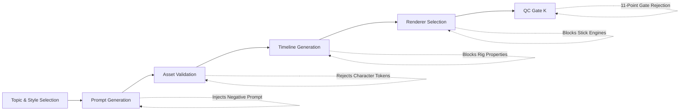

# CrazzyDocs Creative Identity Policy

**Channel:** CrazzyDocs (`@crazzydocs` | Channel ID: `UCUOZOEBngXgt6W7fmus0bvw`)  
**Effective Date:** 2026-11-11  
**Standard:** Phase 5, Stage 3.18 Production Standard  
**Enforcement Module:** `backend/app/content/creative_identity_policy.py` & `backend/app/content/content_integrity_gate.py`  

---

## 1. Core Visual Mission

CrazzyDocs produces high-integrity, curiosity-driven YouTube Shorts. The channel's visual storytelling is defined by authentic historical photography, clean cinematic motion graphics, data visualizations, and technical diagrams.

**Fundamental Invariant:** CrazzyDocs is an authoritative documentary channel. It does NOT produce cartoon host animations, 2D stick figures, or character sketches.

---

## 2. The Four Approved Visual Styles

CrazzyDocs may select between four approved styles based on the topic:

| Style | Key Design Characteristics | Ideal Subject Matter |
|---|---|---|
| **1. Real Images / Documentary** | Authentic open-license archival photography (Wikimedia Commons, BPL, NASA), dynamic Ken Burns motion, obsidian dark slate backgrounds, subtle vignettes. | Historical survival stories, disasters, military history, aviation, biographies. |
| **2. Pop Info** | Editorial cards, high-contrast badge callouts, vibrant punchy color accents, clean typography (Fredoka/Inter). | Bizarre curiosities, cognitive paradoxes, consumer economics, psychology trivia. |
| **3. Chalk Talk** | Technical green/black slate, mathematical formulas, coordinate vectors, orbital arcs, annotated diagrams. **STRICTLY DIAGRAMMATIC — ZERO STICK FIGURES.** | Physics equations, orbital mechanics, planetary geometry, engineering calculations. |
| **4. Creator Motion Graphics** | Kinetic typography (Anton/Inter), RGB glitch accents, sleek geometric motion, particle dynamics, 3D device/data mockups. | Computer science algorithms, technology breakthroughs, viral workflows. |

---

## 3. Global Restrictions & Prohibitions

The following elements are permanently prohibited across all four styles:

1. **No Stick Figures:** Absolutely no 2D stickmen, limb segments, ball heads, or stick figure kinematics.
2. **No Cartoon Characters or Avatars:** No cartoon hosts, talking avatars, or caricatures.
3. **No Character Rigging:** No forward kinematics arm/leg bones, facial rigging, eyebrow states, or mouth phoneme sprites.
4. **No Human-Shaped Doodles:** No human placeholder drawings on slates or in diagrams.
5. **No Legacy Character Renderer Fallback:** The legacy engines (`stick_animation_service.py`, `OptimizedCharacterRig`) are permanently blocked.
6. **No Inter-Scene Style Jumping:** A video must maintain its single assigned style throughout all scenes unless a deliberate editorial transition is explicitly configured.

---

## 4. Black Hole & Space Visual Standards

Astrophysics, cosmology, and black-hole productions must strictly adhere to scientific visualization standards:

- **Approved Motifs:**
  - Glowing accretion disks with Doppler beaming.
  - Photon rings and event horizons.
  - Spacetime curvature grids and gravitational lensing.
  - Authentic NASA, ESA, and ESO telescope imagery.
- **Strictly Prohibited:**
  - Cartoons showing characters falling into singularities.
  - Stick figures with panicked arms ("COULD YOU SURVIVE?").
  - Generic science cartoon animations.

If generative imagery cannot produce an authentic scientific visualization, the pipeline must use authentic NASA/ESO archive imagery or clean diagrammatic motion graphics.

---

## 5. Programmatic Enforcement Pipeline

The Creative Identity Policy is enforced programmatically across six pipeline stages:

1. **Prompt Generation:** `CreativeIdentityPolicy.validate_prompt()` scans for banned tokens and injects `MANDATORY_NEGATIVE_PROMPT`.
2. **Asset Validation:** Manifest assets are verified against banned character names and sprites.
3. **Timeline Generation:** `CreativeIdentityPolicy.validate_timeline_beats()` verifies absence of `arm_left`, `doc_pose`, etc., and enforces style consistency.
4. **Renderer Selection:** `CreativeIdentityPolicy.validate_renderer_selection()` blocks deprecated animation engines.
5. **Quality Control Gate K:** `ContentIntegrityGate` Check K (`CHECK_K_PROHIBITED_ANIMATION`) acts as an immutable pre-publishing gate, blocking any deliverable that violates the policy.

---

## 6. Regression Verification

The policy is verified by automated test suites:
- `backend/tests/test_creative_identity_policy.py` (7 tests)
- `backend/tests/test_stage_3_13a_content_integrity.py` (12 tests)
- `backend/tests/test_stick_animation.py` (1 test)
Total: 20 automated tests proving zero-tolerance enforcement.
