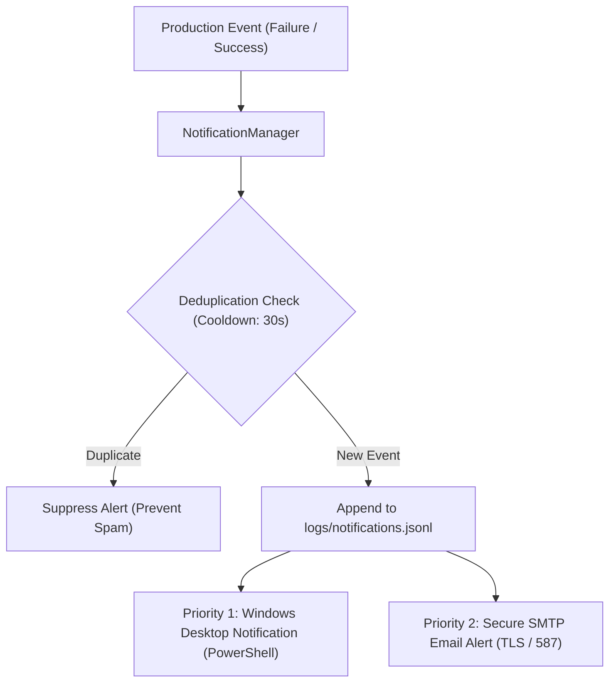

# CrazzyDocs Production Alerting & Failure Notification System

## 1. System Overview

The **CrazzyDocs Production Alerting System** provides unified, real-time alerts across autonomous Shorts production cycles. When an automated stage fails or completes successfully, notifications are dispatched to notify the operator immediately without requiring constant terminal monitoring.

### Core Implementation
- **Source Code:** [`backend/app/services/notification_service.py`](file:///D:/AI%20Arts/AI/backend/app/services/notification_service.py)
- **Persistent Audit Log:** [`logs/notifications.jsonl`](file:///D:/AI%20Arts/AI/logs/notifications.jsonl)
- **Singleton Handler:** `from backend.app.services.notification_service import notification_service`

---

## 2. Notification Channels & Priorities



### Priority 1: Windows Native Desktop Notification
- **Mechanism:** Dispatched via PowerShell (`System.Windows.Forms.NotifyIcon` / WinRT Toast).
- **Zero Third-Party Dependencies:** Uses native Windows OS APIs, requiring no external packages.
- **Visual Distinction:**
  - `FAILURE`: Error icon with alert title and concise error message.
  - `SUCCESS`: Information icon with video filename, runtime, and thumbnail details.
- **Timeout:** 5,000ms balloon display duration with non-blocking execution.
- **Verification Status:** **Tested & Verified Active** on Windows host (`desktop=True`).

### Priority 2: SMTP Email Alerts
- **Mechanism:** Python `smtplib` with `STARTTLS` on port 587 (or SSL on 465).
- **Operational Status:** **PENDING CONFIGURATION** (Awaiting operator setup; desktop alerts active as fallback).
- **Security Boundaries:**
  - Zero hardcoded credentials in source code.
  - Credentials never printed in logs, debug dumps, or terminal output.
  - Stored strictly in local `.env.local` which is explicitly ignored by `.gitignore`.
  - Passwords masked locally via `getpass` (never pasted into agent chat).
- **Interactive Configuration Wizard:**
  Operators configure and verify SMTP delivery locally using:
  ```powershell
  python backend/scripts/configure_email_alerts.py
  ```
  The wizard prompts for:
  1. Recipient email address.
  2. Provider preset (Gmail, Outlook/Office 365, or Custom SMTP).
  3. Sender username and password (for Gmail, a 16-character Google App Password is required; normal account passwords must not be used).
  4. Automatically executes a live test delivery before writing credentials to `.env.local`.

- **Configuration Environment Variables (`.env.local`):**
  ```bash
  # SMTP Server Configuration (Local gitignored secrets)
  CRAZZYDOCS_SMTP_HOST="smtp.gmail.com"
  CRAZZYDOCS_SMTP_PORT=587
  CRAZZYDOCS_SMTP_USER="operator@example.com"
  CRAZZYDOCS_SMTP_PASSWORD="app-specific-password"
  CRAZZYDOCS_ALERT_RECIPIENT="alerts@example.com"
  ```

### Priority 3: Success Notification
- Fired upon full video finalization, outro appending, thumbnail generation, and quality verification.
- Includes final video path, thumbnail path, runtime, resolution, and contact sheet location.

---

## 3. Deduplication & Anti-Spam Architecture

To prevent notification floods during retry loops or cascaded warnings:
- **Deduplication Key:** Formatted as `EVENT_TYPE:STAGE:HASH(ERROR_SUMMARY[:40])`.
- **Cooldown Window:** 30 seconds default cooldown per unique error signature.
- **Log Audit:** Even if a duplicate desktop/email notification is suppressed, all attempts are retained in `logs/notifications.jsonl` for post-run analysis.

---

## 4. Supported Production Stages & Error Codes

| Production Stage | Covered Failure Modes | Notification Type |
|---|---|---|
| `research` | Topic discovery timeout, Wikipedia/Smithsonian API unavailability | `FAILURE` |
| `script` | Hook quality score < 8.0, fact collision, narrative incoherence | `FAILURE` |
| `fact_verification` | Unsubstantiated claims, mathematical contradictions | `FAILURE` |
| `media_acquisition` | Wikimedia commons rate limit, open-license verification failure | `FAILURE` |
| `tts` | Edge-TTS connection error, audio synthesis truncation, emotion tag failure | `FAILURE` |
| `rendering` | FFmpeg pipe deadlock, Pillow rasterization error, font missing | `FAILURE` |
| `compositing` | Audio-video drift, sidechain compression error, outro duration mismatch | `FAILURE` |
| `thumbnail` | 1280x720 dimension violation, contrast threshold failure | `FAILURE` |
| `qc` | Outro subtitle leakage, resolution != 1080x1920, duration outside 50–60s | `FAILURE` |
| `production` | Complete end-to-end production success | `SUCCESS` |

---

## 5. Usage Example in Code

```python
from backend.app.services.notification_service import notification_service

# Failure notification
try:
    # Autonomous production logic
    pass
except Exception as e:
    notification_service.send_failure(
        stage="rendering",
        error_summary=str(e),
        job_id="stage_3_3_molasses",
        log_path="logs/render.log",
        details={"scene_id": "seg_03_rupture", "frames_written": 346}
    )

# Success notification
notification_service.send_success(
    job_id="stage_3_3_molasses",
    stage="production",
    title="Molasses Flood Showcase Complete",
    video_path="media/video/showcase_stage_3_3_molasses_flood.mp4",
    thumbnail_path="media/thumbnails/showcase_stage_3_3_molasses_flood.png",
    duration_sec=54.93,
)
```
