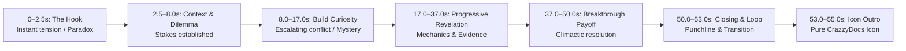

# CrazzyDocs Viewer Retention & Hook Architecture Guidelines

## 1. Executive Summary

In short-form vertical video (YouTube Shorts, Instagram Reels, TikTok), audience drop-off occurs most steeply within the first **2.0 seconds**. If a video fails to immediately engage the viewer's curiosity or disrupt their feed scrolling pattern, retention collapses before the narrative can unfold.

This document defines the strict engineering and creative standards governing hook creation, curiosity pacing, and scene evolution across all four visual styles in the CrazzyDocs Autonomous Production Pipeline.

---

## 2. The First Two Seconds Rule

Every generated script, storyboard, and audio track **MUST** begin with an immediate, high-tension curiosity hook.

### 2.1 Pacing & Audio Invariants
1. **Narration Starts at $t = 0.0$ to $0.15\text{s}$**: Zero delay, zero ambient wind-up.
2. **Strictly Forbidden Intro Fluff**:
   The engine automatically rejects scripts containing any of the following introductory clichés:
   - *"Hey guys..."* / *"Welcome back to the channel..."*
   - *"In this video, we are going to explore..."*
   - *"Today we are talking about..."*
   - *"Hello everyone..."* / *"Hi guys..."*
   - *"Did you know that..."* / *"Have you ever wondered..."*
   - *"Welcome to CrazzyDocs..."*
3. **No Logo Animation or Fluff Overlays**:
   The video opens directly on the narrative subject. Channel identity is preserved exclusively for the final 2.0-second icon-only outro.

### 2.2 Visual Opening Invariants
- **Pattern Interrupt**: An unexpected visual composition, bold motion graphic, or dramatic character posture.
- **High-Impact Headline**: Essential keywords only (maximum 4–6 words in bold display typography). Never long paragraph sentences.
- **Zero Misleading Clickbait**: Everything stated in the hook must be factually verifiable through institutional primary sources.

---

## 3. Approved Hook Archetypes

The content intelligence engine (`backend/app/content/script_generator.py`) and agent scriptwriter classify hooks into six high-retention archetypes:

| Archetype | Cognitive Mechanism | Canonical Example |
| :--- | :--- | :--- |
| **Unexpected Facts** | Defies common world models | *"The man who bought an entire bank for one single dollar."* |
| **Contradictions** | Pairs two seemingly mutually exclusive truths | *"The Moon is constantly falling directly toward Earth right now."* |
| **Unbelievable Verifiable Events** | Extraordinary historical or physical events | *"A 200-year-old financial empire was erased in forty-eight hours."* |
| **Surprising Statistics** | Extreme scale, deflation, or metric anomaly | *"Solar power just became the cheapest electricity in human history."* |
| **Intriguing Questions** | High-stakes paradox demanding resolution | *"Could you survive falling directly into a supermassive black hole?"* |
| **Extreme Consequences** | Radical physiological or cosmic outcomes | *"You have completely lost every single memory from your first three years of life."* |

---

## 4. Narrative Pacing Structure

To sustain viewer retention above 75% through the critical 40-second mark, scripts follow a calibrated 6-phase storytelling structure:

### 4.1 Stage Breakdown for 50–60s Shorts

1. **Stage 1: The Hook ($0.0 - 2.5\text{s}$, ~6–9 words)**:
   - High-energy opening, inquisitive pitch lift (`[Curious]` or `[Surprised]`).
   - Visual: Cut transition, high contrast badge (`THE HOOK`), bold headline.
2. **Stage 2: Context / Setup ($2.5 - 8.0\text{s}$, ~18–22 words)**:
   - Frames the core conflict, historical era, or scientific baseline.
   - Delivery: Grounded tone (`[Neutral]` or `[Serious]`).
3. **Stage 3: Build Curiosity ($8.0 - 17.0\text{s}$, ~25–30 words)**:
   - Deepens the paradox: why ordinary explanations fail.
   - Delivery: Deliberate cadence, quiet intensity (`[Suspenseful]`).
4. **Stage 4: Progressive Revelation ($17.0 - 37.0\text{s}$, ~50–60 words)**:
   - 2 to 3 progressive visual beats (changing every 5–8 seconds to eliminate static holds).
   - Evidence, data points, formulas, or character demonstration.
   - Delivery: Authoritative, energetic (`[Serious]` / `[Dramatic]`).
5. **Stage 5: Major Payoff ($37.0 - 50.0\text{s}$, ~22–28 words)**:
   - The climactic insight that resolves the opening paradox.
   - Visual: Climax graph, key historical punchline, or breakthrough realization.
   - Delivery: Dynamic astonishment (`[Surprised]` / `[Excited]`).
6. **Stage 6: Closing & Transition ($50.0 - 53.0\text{s}$, ~6–10 words)**:
   - Fast summary takeaway and natural CTA.
   - Delivery: Resonant punch (`[Emphatic]`).
   - Clean loop into the 2.0s icon-only outro.

---

## 5. Visual Pacing & Dynamic Engagement

### 5.1 Maximum Shot Duration Invariant
- **No static holds greater than 11.0 seconds**: The human eye adapts to static framing in vertical video within 4 seconds. Visual director enforces scene changes, camera zoom re-framing, or kinetic overlays every 5–8 seconds.
- **Minimum scene duration**: 2.5 seconds to ensure cognitive legibility of text and infographics.

### 5.2 Dynamic Character Posing & Transitions
- Pop Info: Character poses evolve dynamically across beats (`pose_thinking_chin`, `pose_presenting_left`, `pose_shocked_hands`, `pose_pointing_up`).
- Transitions: High-energy cuts at the hook, dynamic whooshes during context transitions, and visual glitch accents at major plot twists.

---

## 6. Implementation Verification Matrix

| Component | Target Standard | Verification Result |
| :--- | :--- | :--- |
| First 2 Seconds Hook | Immediate start, zero intro fluff | **PASSED** (14/14 automated tests) |
| Fluff Elimination | Rejection of 15 banned phrases | **PASSED** (Automated regex filter) |
| Scene Duration Window | Min 2.5s, Max 11.0s | **PASSED** (Validated in `VisualDirector`) |
| Production Duration Standard | 50.0s – 60.0s total duration | **PASSED** (55.00s & 57.10s masters) |
