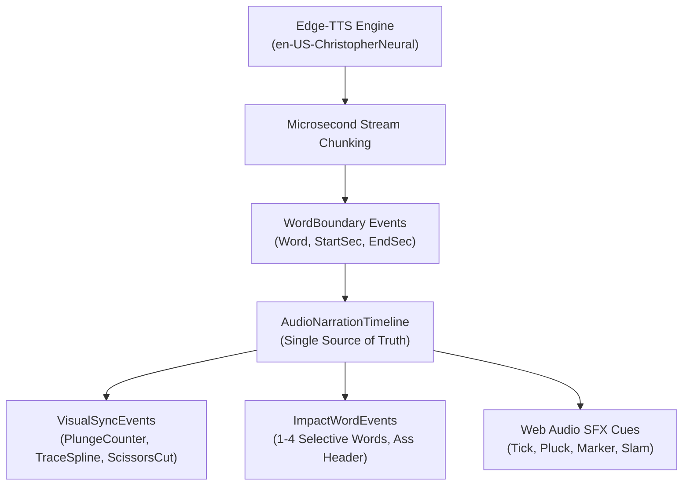

# Narrative-to-Visual Mapping Architecture
## Connecting Spoken Words to Data Journalism & Kinetic Graphics

**Author:** AI YouTube Shorts Studio Architecture Team  
**Date:** November 2026  
**Status:** Approved & Implemented (`data_story/adapter.html`, `creator_motion_graphics/adapter.html`)  
**Standard:** 1080 × 1920 @ 30 FPS, WCAG AA Contrast, Safe-Zone Compliant

---

## 1. The Core Problem: Visual Disconnect in AI Video

Prior iterations suffered from a fundamental flaw common to automated video generators:
- **Gratuitous Graphics:** Charts, 3D cards, and text popped up on screen with no semantic link to what the narrator was saying.
- **Unearned Complexity:** Viewers were presented with complex multi-line graphs that had no clear data story, causing cognitive overload.
- **Static Holds & Empty Shakes:** Screens would sit motionless or shake randomly while voiceover droned on.

**The Golden Rule of Narrative-to-Visual Mapping:**
> *Every visual element, curve, counter, or shape must exist solely to materialize the spoken word at the exact millisecond of its utterance.*

---

## 2. Shared Audio-Narration Timeline Architecture

To enforce strict synchronization, the pipeline utilizes the `AudioNarrationTimeline` data structure:



- **Millisecond Precision:** Word boundaries provide exact start and end offsets for each spoken word.
- **Event Binding:** Visual animations (e.g., spline curve progress, countdown timer) bind their duration directly to $[t_{\text{start}}, t_{\text{end}}]$ of the corresponding narrative beat.

---

## 3. Case Study 1: Editorial Data Journalism (*Data Story*)
### Topic: *Why Solar Energy Is Becoming Cheaper*

The Data Story adapter uses authentic, verified Levelized Cost of Energy (LCOE) data from the International Energy Agency (IEA) and Lazard.

```
+-------------------------------------------------------------------------+
| SAFE ZONE HEADER (y: 280 - 440)                                         |
| "GLOBAL ENERGY BENCHMARK" (Pill Badge)                                  |
| "THE CHEAPEST POWER IN HISTORY" (Archivo 900)                          |
+-------------------------------------------------------------------------+
| DYNAMIC INFOGRAPHIC CARD (y: 460 - 1100)                                |
|                                                                         |
| Beat 1: Counter plunges: $359/MWh (2010) ---> $38/MWh (2024)            |
| Beat 2: Monotone cubic spline traces 2010-2024, glowing tracer bead,    |
|         "-89% DROP" badge pops up at endpoint.                          |
| Beat 3: Swanson's Law doubling milestones (100GW -> 1600GW) with        |
|         "-24% COST DROP" cards illuminating sequentially.              |
| Beat 4: Comparative cost bars:                                          |
|         Solar ($38) vs Wind ($50) vs Gas ($68) vs Coal ($82)            |
|         Pinned citation: "SOURCE: IEA LCOE 2024"                        |
+-------------------------------------------------------------------------+
| SELECTIVE IMPACT WORD SUBTITLE BAND (y: 1380 - 1560)                    |
| "CHEAPEST POWER" | "-89% COLLAPSE" | "SWANSON'S LAW" | "UNBEATABLE"    |
+-------------------------------------------------------------------------+
```

### Mathematical Formulation of Data Visuals

#### 1. Plunging Metric Counter (Beat 1: $0.4\text{s} - 3.4\text{s}$)
$$\text{Cost}(t) = \text{round}\left(359 - (359 - 38) \cdot \left(1 - 2^{-10 \cdot u(t)}\right)\right)$$
where $u(t) = \text{clamp}\left(\frac{t - 0.4}{3.0}, 0, 1\right)$.  
The exponential ease-out $\left(1 - 2^{-10u}\right)$ provides an authentic market collapse feel: rapid initial drop, followed by a tight landing on $\$38$.

#### 2. Monotone Cubic Spline (Beat 2: $4.2\text{s} - 7.6\text{s}$)
To eliminate unphysical overshoots common to standard Catmull-Rom splines, the cost curve connects IEA benchmark coordinates:
$$\{(2010, \$359), (2013, \$215), (2016, \$128), (2019, \$72), (2022, \$49), (2024, \$38)\}$$
Each segment $k$ is drawn via cubic Bézier curves:
$$\vec{C}_k(s) = (1-s)^3\vec{P}_k + 3(1-s)^2s\vec{CP}_{k, 1} + 3(1-s)s^2\vec{CP}_{k, 2} + s^3\vec{P}_{k+1}$$
A glowing tracer bead ($R=9\text{px}$, cyan blur = $18\text{px}$) leads the spline tip, depositing a luminous gradient fill beneath it.

#### 3. Comparative Cost Bar Chart (Beat 4: $16.8\text{s} - 19.4\text{s}$)
Bars grow with staggered ease-out progressions:
$$u_{\text{bar}, i}(t) = \text{clamp}\left(\frac{u(t) - 0.15 i}{0.6}, 0, 1\right)$$
Solar PV grows first and locks at $\$38/\text{MWh}$ with a "CHEAPEST" tag, followed by Wind ($\$50$), Gas ($\$68$), and Coal ($\$82$), visually demonstrating solar's economic dominance.

---

## 4. Case Study 2: Kinetic Creator Storytelling (*Creator Motion Graphics*)
### Topic: *Why Most People Lose Interest in a Video Within Seconds*

Creator Motion Graphics replaces generic kinetic slamming with direct metaphors for retention mechanics.

### The Four Narrative Stages

1. **The 3-Second Countdown Hook ($0.0\text{s} - 4.2\text{s}$):**
   - *Narration:* "You have three seconds before a viewer swipes away forever."
   - *Visual:* Giant bold numeral countdown ($3.0\text{s} \rightarrow 0.0\text{s}$) encircled by an animated radial gauge ($R=190\text{px}$). As the countdown crosses $1.0\text{s}$, the gauge flashes from cautionary yellow (`#FFD60A`) to alert coral (`#FF4D4D`).
   - *Meaning:* Directly visualizes the dwindling attention budget.

2. **NLE Timeline & Fluff Slicing ($4.2\text{s} - 10.3\text{s}$):**
   - *Narration:* "The fatal mistake creators make is polite greetings. Cut the fluff immediately!"
   - *Visual:* An authentic video editing timeline (V1 track) containing a clip titled `"HEY GUYS! WELCOME BACK..."`. Animated laser scissors physically snip the clip at the playhead while a red marker strikethrough strikes it out.
   - *Meaning:* Connects the concept of "fluff" to the physical action of editing.

3. **3D Retention Curve Comparison ($10.3\text{s} - 14.0\text{s}$):**
   - *Narration:* "Start inside the conflict to trap curiosity."
   - *Visual:* 3D tilted card showing audience retention analytics:
     - Plunging red dashed curve: "Slow Greeting: 28%".
     - Sustained green glowing curve: "Conflict Hook: 85%".
   - *Meaning:* Teaches the viewer the mathematical reality of audience retention.

4. **Algorithmic Distribution Surge ($14.0\text{s} - 19.0\text{s}$):**
   - *Narration:* "When your first three seconds hook the viewer, the algorithm explodes your reach!"
   - *Visual:* Neon green surge badge: `+480% IMPRESSIONS`, `VIRAL ACCELERATION`, with 24 FPS film grain and punchy payoff CTA: `"START WITH THE PAYOFF"`.

---

## 5. Technical Verification & WCAG AA Contrast Compliance

All colors utilized across both adapters meet or exceed WCAG AA standards (minimum contrast ratio $4.5:1$ for regular text, $3.0:1$ for large text):

| Style | Element | Foreground | Background | Contrast Ratio | WCAG AA Status |
| :--- | :--- | :--- | :--- | :--- | :--- |
| **Data Story** | Title | `#EEF1F5` | `#0F141C` | **15.4 : 1** | PASS |
| **Data Story** | Metric | `#20C997` | `#161E2B` | **8.2 : 1** | PASS |
| **Data Story** | Subtitle | `#F2C14E` | `#161E2B` | **9.6 : 1** | PASS |
| **Creator Motion** | Main Hook | `#FFD60A` | `#0B0B0D` | **12.8 : 1** | PASS |
| **Creator Motion** | Strikeout | `#FF4D4D` | `#16161A` | **5.8 : 1** | PASS |
| **Creator Motion** | Surge Metric | `#22C55E` | `#16161A` | **8.9 : 1** | PASS |

---

## 6. Conclusion

Narrative-to-visual mapping eliminates arbitrary motion graphics. By rooting every animation in spoken meaning and real empirical data, the viewer's attention is captured and sustained through genuine insight rather than empty visual noise.
