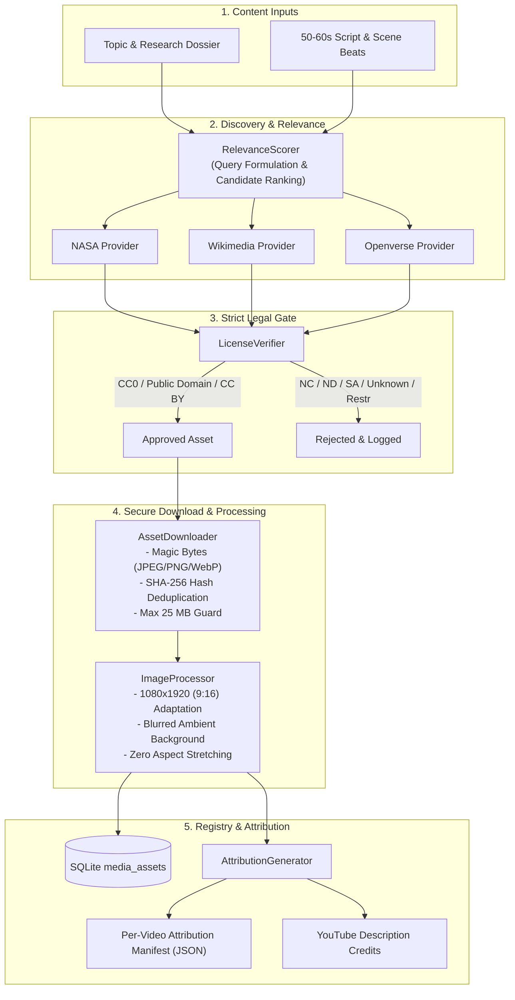

# Openly Licensed Media Acquisition Subsystem
## Automated Discovery, Strict License Verification, Portrait Adaptation, and Legal Attribution

**Project Root:** `D:\AI Arts\AI\`  
**Date:** November 10, 2026  
**Status:** Stage 2 Completed & Verified (22/22 Automated Tests Passed)  
**Standard:** Local-First, Zero-Marginal-Cost Architecture

---

## 1. Architectural Overview & Objective

Stage 2 establishes the **Openly Licensed Media Engine** (`backend/app/media/`), eliminating reliance on generic AI illustrations, stock backgrounds, or stick figures.

The subsystem automatically acquires real photographs, space imagery, scientific illustrations, and diagrams from verified open repositories:
1. **Official Provider Integrations:** Openverse, Wikimedia Commons, NASA Image & Video Library via official non-scraping APIs.
2. **Strict Legal License Verification (`license_verifier.py`):** Automatically accepts `CC0`, `Public Domain`, `US Government Work`, and `CC BY`. Rejects `CC BY-NC` (commercial risk), `CC BY-ND` (adaptation risk), `CC BY-SA` (copyleft risk), missing, and ambiguous licenses.
3. **Semantic Relevance & Scoring (`relevance_scorer.py`):** Generates scene-specific queries from topics and scripts, weighting semantic overlap, resolution ($\ge 1080\text{px}$), and license confidence.
4. **Secure Streaming Downloader (`downloader.py`):** Enforces file signature / magic-byte verification (JPEG, PNG, WebP), Pillow decompression bomb protection, max 25 MB limit, and SHA-256 deduplication.
5. **Portrait Adaptation (`image_processor.py`):** Adapts arbitrary aspect ratios to 1080x1920 (9:16 vertical) without unnatural stretching using blurred ambient background plates, center cropping, or smart focal crops.
6. **Legal Attribution Manifests (`attribution_generator.py`):** Compiles structured per-video JSON manifests and ready-to-publish YouTube description credit blocks.
7. **SQLite Registry (`asset_registry.py`):** Persists all asset metadata, hashes, and usage records into `media_assets`.

---

## 2. Component Pipeline Architecture



---

## 3. Directory Layout & Storage

```
D:\AI Arts\AI\
├── backend\app\media\
│   ├── __init__.py                  # Package interface
│   ├── models.py                    # MediaAsset, LicenseType, LicenseStatus, AttributionManifest
│   ├── license_verifier.py          # Strict legal policy enforcement engine
│   ├── relevance_scorer.py          # Semantic relevance & query generator
│   ├── downloader.py                # Secure streaming downloader with signature checks
│   ├── image_processor.py           # 1080x1920 portrait adaptation (Blurred BG, Center, Focal)
│   ├── attribution_generator.py     # Attribution manifest compiler & YouTube description exporter
│   ├── asset_registry.py            # SQLite CRUD & SHA-256 deduplication
│   ├── acquisition_manager.py       # Master MediaAcquisitionEngine coordinator
│   └── providers\
│       ├── __init__.py
│       ├── base_provider.py         # Abstract BaseMediaProvider interface
│       ├── nasa_provider.py         # NASA Image & Video Library official API client
│       ├── wikimedia_provider.py    # Wikimedia Commons official API client
│       └── openverse_provider.py    # Openverse official API client
│
├── assets\media_library\
│   ├── images\                      # Downloaded original source images (.gitignored)
│   ├── portrait\                    # 1080x1920 adapted portrait versions (.gitignored)
│   └── manifests\                   # Per-video attribution JSON manifests
└── cache\media_downloads\           # Transient download stream buffer
```

---

## 4. Key Performance & Security Standards

1. **Local-First & Zero-Cost:** Pure Python (Pillow, urllib, hashlib) with zero paid cloud dependencies, perfectly optimized for AMD Ryzen 7 3700U CPU.
2. **Path Traversal Protection:** All downloaded filenames are strictly sanitized via regex stripping path traversal sequences (`../`, `..\`).
3. **Decompression Bomb Guard:** `Image.MAX_IMAGE_PIXELS = 80_000_000` prevents malicious decompression attacks.
4. **Magic Byte Signature Inspection:** Validates genuine leading binary bytes (`FF D8 FF` for JPEG, `89 50 4E 47` for PNG, `RIFF...WEBP` for WebP), completely rejecting disguised or executable files.
5. **Deduplication:** Computes SHA-256 file hashes on download, immediately skipping redundant network traffic if an identical asset exists on disk or in the SQLite database.
