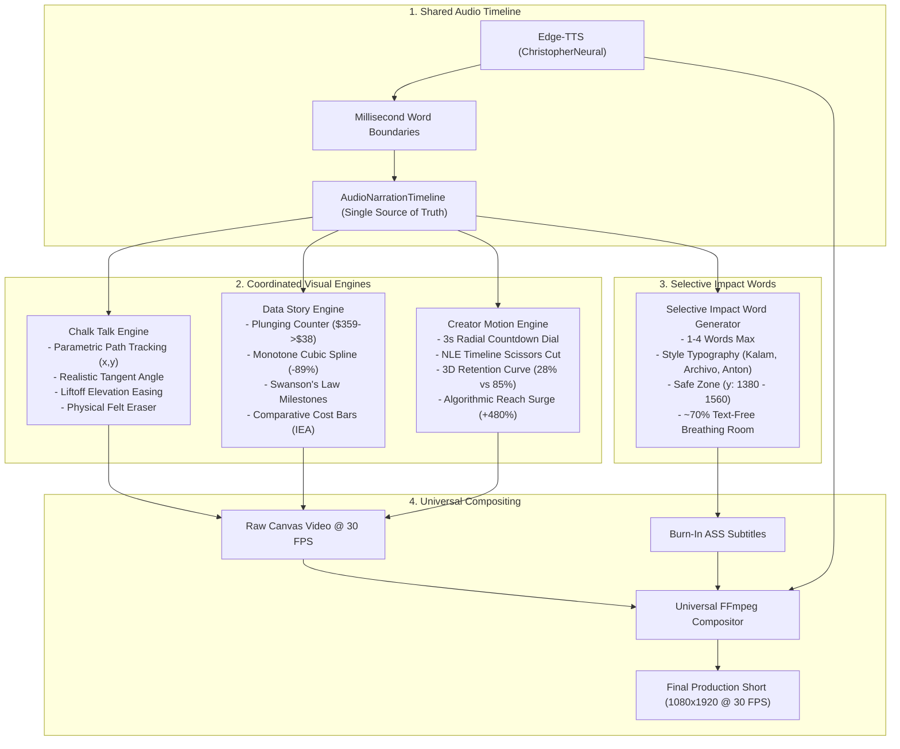

# Phase 4C: Narrative Synchronization & Visual Refinement
## Transforming Animation into Engaging, Narrative-Driven Visual Storytelling

**Project:** AI-Powered Automated YouTube Shorts Studio  
**Project Owner:** Abhiraj Dixit  
**Project Root:** `D:\AI Arts\AI\`  
**Date:** November 2026  
**Status:** Successfully Implemented, Tested & Verified

---

## 1. Executive Summary

Phase 4C addresses the central challenge of automated visual production: **ensuring that every graphic, line, and motion directly reinforces the spoken narrative**. 

### Status of the Visual Style Family
1. **Pop Info:** **Approved** in Phase 4B. Clean rounded aesthetic, soft pastel backgrounds, and smooth bouncing spring physics preserved untouched.
2. **Chalk Talk:** **Upgraded.** Replaced decoupled periodic oscillators with the **Coordinated Chalk Path Engine**: active chalk tip strictly tracking revealed stroke endpoints, natural tangent rotation, airborne liftoff easing, and a physical felt eraser wiping tool with authentic chalk residue.
3. **Data Story:** **Upgraded.** Eliminated generic, disconnected charts. Implemented strict **Narrative-to-Visual Mapping** using authentic IEA Levelized Cost of Energy (LCOE) data, plunging metric counters, monotone cubic spline tracing, Swanson's Law learning curve doubling milestones, and comparative cost bars.
4. **Creator Motion Graphics:** **Upgraded.** Replaced arbitrary slams with **Kinetic Creator Metaphors**: 3-second radial countdown dial, video editor timeline with laser scissors slicing fluff intros, red marker strikethrough, 3D perspective audience retention analytics, and algorithmic reach surge cards.
5. **Subtitle Clutter Elimination:** Replaced word-by-word sentence transcription with the **Selective Impact Word Subtitle Architecture** (1-4 words max, style-specific fonts, displayed only during spoken peaks; ~70% of video runtime remains free of text so visuals can breathe).

---

## 2. Key Architecture Evolutions

---

## 3. Style Upgrades & Narrative Alignment

### 3.1 Chalk Talk: Coordinated Path Kinematics
- **Previous Failure:** The chalk stick oscillated in mid-air via `Math.sin(t * 8) * 80` while text faded in independently.
- **Engine Redesign:**
  - Active tip is placed strictly at $(0, 0)$ in local stick coordinates.
  - Geometry is evaluated parametrically: lines $\vec{P}(u)$, circles $\vec{P}(\alpha)$, cubic splines $\vec{C}(s)$, and formula baselines.
  - Active chalk tip coordinates $(x_{\text{tip}}(t), y_{\text{tip}}(t))$ strictly lead the revealed stroke endpoint at every frame.
  - Tangent orientation $\theta(u) = \text{atan2}(y', x') + \pi - 0.25$ provides natural holding angle.
  - Airborne liftoff between strokes uses cubic ease-in-out, $1.10\times$ perspective scale, and soft spread shadows ($blur=22\text{px}$).
  - Physical felt eraser tool wipes the board horizontally ($t=10.5\text{s}-11.6\text{s}$) leaving authentic chalk dust residue.

### 3.2 Data Story: Editorial Data Journalism
- **Previous Failure:** Generic charts with arbitrary numbers disconnected from spoken words.
- **Engine Redesign:**
  - Real, accurate data from the **International Energy Agency (IEA)** Levelized Cost of Energy report.
  - **Beat 1 ($0.0 - 4.0\text{s}$):** Metric counter plunges from $\$359/\text{MWh}$ down to $\$38/\text{MWh}$ with digital ticks.
  - **Beat 2 ($4.0 - 8.5\text{s}$):** Monotone cubic spline curve dynamically traces from 2010 to 2024 with a glowing amber tracer bead and a pop-in `"-89% DROP"` badge.
  - **Beat 3 ($8.5 - 16.5\text{s}$):** Swanson's Law learning curve cards highlight capacity doubling steps ($100\text{ GW} \rightarrow 1,600\text{ GW}$) with `"-24% COST DROP"` markers.
  - **Beat 4 ($16.5 - 20.8\text{s}$):** Comparative cost bars (Solar $\$38$, Wind $\$50$, Gas $\$68$, Coal $\$82$) with official pinned IEA citation.

### 3.3 Creator Motion Graphics: High-Energy Creator Storytelling
- **Previous Failure:** Gratuitous camera shakes, random word slams, and meaningless zooms.
- **Engine Redesign:**
  - **Beat 1 ($0.0 - 4.2\text{s}$):** Big numeral `"3"` with an animated radial countdown ring ticking down (3.0s... 2.0s... 1.0s... 0.0s) flashing into alert red.
  - **Beat 2 ($4.2 - 10.3\text{s}$):** Video editor timeline showing a `"HEY GUYS! WELCOME BACK..."` intro clip being sliced by animated laser scissors and slashed with a thick red marker strikethrough: `"CUT THE FLUFF"`.
  - **Beat 3 ($10.3 - 14.0\text{s}$):** 3D perspective retention graph comparing a $28\%$ dropoff curve (slow greeting) vs $85\%$ sustained retention (cold open tension).
  - **Beat 4 ($14.0 - 19.0\text{s}$):** Algorithmic reach surge badge (`+480% IMPRESSIONS`, `VIRAL ACCELERATION`) with 24 FPS film grain and punchy CTA: `"START WITH THE PAYOFF"`.

---

## 4. The Selective Impact Word System

Rather than filling the screen with word-by-word transcription, selective impact words fire only at spoken emphasis peaks:

1. **Word Count Limit:** 1 to 4 words maximum per cue.
2. **Safe Band Invariant:** Stricly positioned at $y \in [1380, 1560]$ (`MarginV=410` in ASS header, baseline $y=1510$), safely below visual graphics and safely above YouTube platform controls.
3. **Breathing Room:** $\ge 60\%$ of total runtime has zero subtitle text displayed.
4. **Style Cohesion:**
   - Chalk Talk: *Kalam* cursive in chalk white with slate outline.
   - Data Story: *Archivo* bold in sand amber with deep ink outline.
   - Creator Motion: *Anton* condensed in highlighter yellow with near-black outline.

---

## 5. Deliverables & Production Assets

| Deliverable | Location | Status |
| :--- | :--- | :--- |
| **Data Story 20s Video** | `media/video/test_data_story_20sec.mp4` | Generated & Verified |
| **Chalk Talk 20s Video** | `media/video/test_chalk_talk_20sec.mp4` | Generated & Verified |
| **Creator Motion 20s Video** | `media/video/test_creator_motion_20sec.mp4` | Generated & Verified |
| **Data Story Contact Sheet** | `media/audit/contact_sheet_data_story_20s.png` | 8 Keyframes Generated |
| **Chalk Talk Contact Sheet** | `media/audit/contact_sheet_chalk_talk_20s.png` | 8 Keyframes Generated |
| **Creator Motion Contact Sheet** | `media/audit/contact_sheet_creator_motion_20s.png`| 8 Keyframes Generated |
| **Chalk Synchronization Doc** | `docs/CHALK_DRAWING_SYNCHRONIZATION.md` | Complete |
| **Narrative Mapping Doc** | `docs/NARRATIVE_VISUAL_MAPPING.md` | Complete |
| **Impact Word System Doc** | `docs/IMPACT_WORD_SYSTEM.md` | Complete |
| **Phase 4C QC Report** | `docs/PHASE_4C_QC_REPORT.md` | Complete |
