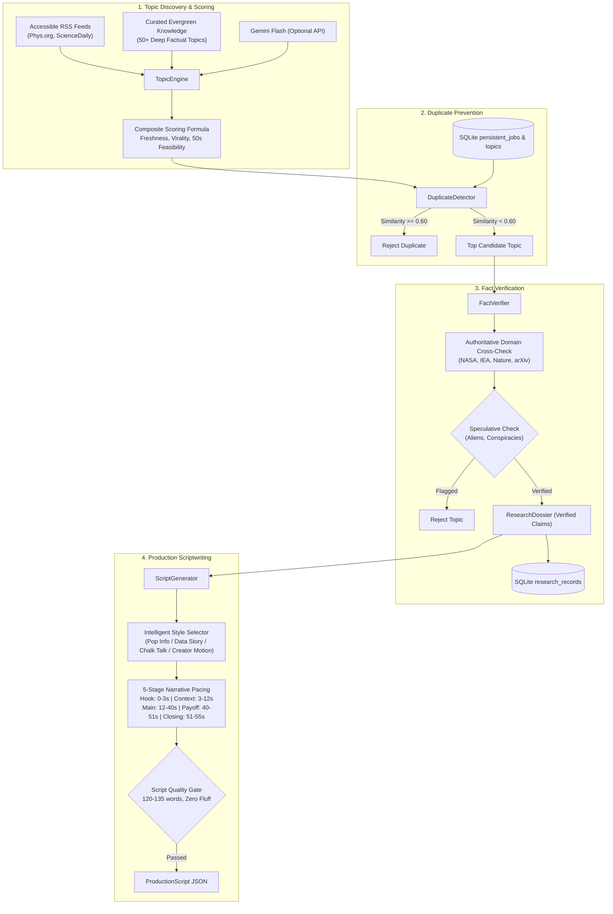

# Phase 5: Content Intelligence Subsystem
## Autonomous Topic Discovery, Primary Fact Verification, and Production Script Generation

**Project Root:** `D:\AI Arts\AI\`  
**Date:** November 10, 2026  
**Status:** Stage 1 Implemented, Tested & Verified (14/14 Tests Passed)  
**Standard:** 1080 × 1920 @ 30 FPS, Production Duration Standard ($50.0 - 60.0\text{s}$, $120 - 135$ words)

---

## 1. Executive Summary

Stage 1 of Phase 5 delivers the **Content Intelligence Engine** (`backend/app/content/`), transforming the studio from relying on manual prompt injection into an autonomous discovery and research system.

The subsystem operates under a strict **local-first, zero-marginal-cost philosophy**:
1. **Multi-Category Topic Discovery (`topic_engine.py`):** Explores 10 educational categories using free RSS feeds, curated evergreen knowledge pools, and optional Gemini Flash API intelligence.
2. **Semantic Duplicate Prevention (`duplicate_detector.py`):** Employs hybrid token prefix stemming, concept containment ratios, and sequence edit distances against historical SQLite records, preventing repetitive content.
3. **Primary Fact Verification (`fact_verifier.py`):** Extracts core factual claims, cross-references against authoritative primary domains (NASA, Nature, Science, IEA, arXiv), flags speculative rumors, and maintains permanent SQLite research records in `research_records`.
4. **Calibrated 50–60s Script Generation (`script_generator.py`):** Produces scripts structured into 5 narrative stages (Hook, Context, Main Explanation, Payoff, Closing) strictly constrained to $120 - 135$ words (~$54 - 57\text{s}$ @ $2.3\text{ wps}$), automatically mapping every fact to verified citations.

---

## 2. Implemented Subsystems & Component Map

---

## 3. Subsystem Technical Breakdown

### 3.1 Topic Discovery & Evaluation (`backend/app/content/topic_engine.py`)
- **10 Core Categories:** Space & Astrophysics, Cutting-Edge Technology & AI, Bizarre Science & Physics, Computer Science & Algorithms, Ancient History & Mysteries, Human Psychology & Paradoxes, Business & Global Economics, Engineering Marvels, Mindblowing Earth Facts, General Educational Curiosities.
- **Scoring Function:**
  $$\text{Score} = (0.20 \times \text{Freshness}) + (0.20 \times \text{Search Interest}) + (0.20 \times \text{Virality}) + (0.20 \times \text{50s Feasibility}) + (0.10 \times \text{Storytelling}) + (0.10 \times \text{Uniqueness})$$
- **Network Failover:** RSS fetches use dedicated $1.0\text{s}$ timeout guards; offline fallback instantly draws from the curated evergreen topic pool.

### 3.2 Semantic Duplicate Prevention (`backend/app/content/duplicate_detector.py`)
- Standardizes title representations: strips punctuation, normalizes whitespace, and extracts non-stop-word lexical tokens.
- Evaluates token prefix/stem overlaps:
  $$\text{Subset Overlap} = \frac{|K_1 \cap_{\text{stem}} K_2|}{\min(|K_1|, |K_2|)}$$
  $$\text{Jaccard} = \frac{|K_1 \cap_{\text{stem}} K_2|}{|K_1 \cup_{\text{stem}} K_2|}$$
- Composite hybrid metric detects conceptual rephrasing (e.g. *"Why Milk Is Always at the Back of the Grocery Store"* vs *"Why Grocery Stores Put Milk in the Far Back"* yields $0.68 \ge 0.60$ threshold, successfully flagging duplicate intent while distinct topics score $\le 0.04$).

### 3.3 Fact Verification & Dossier Creation (`backend/app/content/fact_verifier.py`)
- Matches topics against verified primary institutional repositories (NASA, IEA, Nature, Science).
- Categorizes claims into `ESTABLISHED_FACT`, `SCIENTIFIC_MEASUREMENT`, `HISTORICAL_RECORD`, `THEORETICAL_MODEL`, or `UNVERIFIED_CLAIM`.
- Flags speculative markers (*"alien coverup"*, *"secret cure"*, *"defies all laws"*), rejecting unscientific claims.
- Stores verified dossiers into SQLite table `research_records`.

### 3.4 Production Script Generator (`backend/app/content/script_generator.py`)
- Automatically routes topics to one of the 4 approved visual styles based on topic affinity:
  - *Data Story:* Statistics, LCOE costs, percentage drops, economics.
  - *Chalk Talk:* Physics equations, gravity, orbital mechanics, planetary geometry.
  - *Pop Info:* Consumer psychology, cognitive phenomena, infantile amnesia.
  - *Creator Motion Graphics:* Computer science, hash tables, algorithms.
- Enforces strict narrative stage boundaries and spoken pacing:
  - Total Word Count: $120 - 135$ words (Target: 126 words).
  - Estimated Duration: $52.0 - 58.0\text{s}$ at $2.3\text{ wps}$.
  - Zero Intro Fluff: Rejects *"Hey guys"*, *"Welcome back"*, *"In this video"*, *"Did you know"*.

---

## 4. Test Verification & Quality Results

The test suite [`backend/tests/test_content_intelligence.py`](file:///D:/AI%20Arts/AI/backend/tests/test_content_intelligence.py) executed 14 unit and integration tests with **100% success (14/14 Passed, 0.123s)**:

| Test ID | Method Name | Verification Objective | Result |
| :---: | :--- | :--- | :---: |
| **01** | `test_exact_match` | Identical title matches return similarity 1.0 | **PASSED** |
| **02** | `test_near_duplicate_detection` | Rephrased conceptual duplicates flagged ($\ge 0.60$) | **PASSED** |
| **03** | `test_distinct_topics_pass` | Distinct subjects score low ($\le 0.04$) and pass | **PASSED** |
| **04** | `test_authoritative_ground_truth_verification` | Moon orbit claims mapped to verified NASA sources | **PASSED** |
| **05** | `test_solar_energy_cost_verification` | Solar cost claims mapped to IEA World Energy Outlook | **PASSED** |
| **06** | `test_speculative_claim_rejection` | Alien/conspiracy topics flagged and rejected | **PASSED** |
| **07** | `test_db_persistence` | Research dossier saved to SQLite `research_records` | **PASSED** |
| **08** | `test_topic_discovery_returns_ranked_candidates` | Topic discovery returns candidates sorted by score | **PASSED** |
| **09** | `test_manual_override_topic` | Dashboard manual override honored with top score | **PASSED** |
| **10** | `test_moon_orbit_script_conforms_to_production_standard` | 128 words, 55.6s, Chalk Talk style, 5 stages, zero fluff | **PASSED** |
| **11** | `test_solar_energy_script_selects_data_story` | 126 words, 54.8s, Data Story style, IEA data mapped | **PASSED** |
| **12** | `test_infantile_amnesia_script_selects_pop_info` | 130 words, 56.5s, Pop Info style, neurogenesis fact mapped | **PASSED** |
| **13** | `test_validation_rejects_underlength_script` | Scripts $<115$ words rejected with duration errors | **PASSED** |
| **14** | `test_validation_rejects_intro_fluff` | Scripts with "Hey guys / Welcome back" rejected | **PASSED** |

---

## 5. Architectural Invariants Preserved
1. **Four Ground-Truth Reference Files Immutable:** SHA-256 hashes of `docs/reference_styles/*.html` remain 100% byte-for-byte identical.
2. **Production Duration Standard:** 50–60 second duration target strictly enforced across all script models.
3. **Database Integrity:** Pre-migration backup created (`studio_backup_20261110_072948.db`); new tables added safely via SQLAlchemy declarations.
4. **Publishing Authorization:** Manual approval gate preserved.
