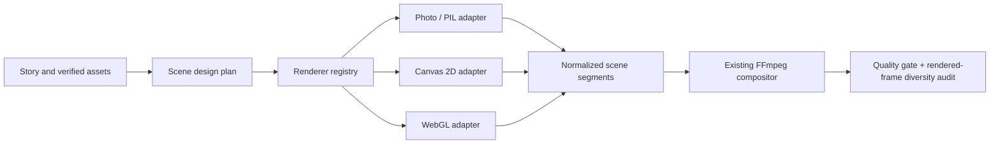

# Stage 3.21O — Lemo-Opuscar Renderer Architecture Research

**Assessment:** `PARTIALLY ADOPT`

**Scope:** Read-only technical research into [lemomo-ai/lemo-opuscar](https://github.com/lemomo-ai/lemo-opuscar) and its possible contribution to CrazzyDocs. No dependency installation or production-code change was made for this report. The report itself is a new documentation artifact.

## Executive recommendation

Adopt Lemo-Opuscar's **style-as-renderer-grammar** approach, per-scene camera/composition planning, deterministic timeline-driven rendering, and genuine composition diversity checks. Keep CrazzyDocs' existing script, asset provenance, narration, FFmpeg finishing, and publishing-safety pipeline. Do not copy its framework wholesale or equate a detailed `STYLE.md` with a renderer implementation: Lemo-Opuscar's strongest evidence is the combination of style contracts and coded demonstrations, while CrazzyDocs already has viable Python, browser-canvas, and FFmpeg components that can host compatible adapters.

The evidence supports real visual divergence. For example, Chalkboard draws ordered pressure-aware marks on a board; Swiss Motion composes type on a strict grid; Satellite Briefing maps georeferenced marks through a globe-to-ground camera; Transit Map draws a network onto a physical sheet and rides the pen tip. Those are different scene models and camera grammars, not palette swaps. Their layouts are also deliberately unlike one another.

## Repository structure and operating model

The public repository root exposes `.claude-plugin/`, `.github/`, `core/`, `docs/`, `plugin/`, `styleboard/`, `styles/`, `tools/`, and root guidance/configuration including `AGENTS.md`, `DIRECTOR.md`, `TECHNIQUE.md`, `MAINTAINING.md`, `MY-STYLES.md`, `package.json`, `requirements.txt`, `LICENSE`, and README files. The style index groups 66 individual style directories. Each style folder is intended to pair `STYLE.md` with a coded demo (`DEMO.md` and code); `core/` contains the reusable renderer and utilities. The upstream guidance treats `STYLE.md` as an invariant visual grammar and directs film-specific treatment, shot list, and code to a separate project. [Repository](https://github.com/lemomo-ai/lemo-opuscar) · [AGENTS.md](https://github.com/lemomo-ai/lemo-opuscar/blob/main/AGENTS.md) · [style index](https://github.com/lemomo-ai/lemo-opuscar/blob/main/styles/README.md)

The root guidance and production docs describe a pipeline in which a story treatment and shot design precede renderer code. `DIRECTOR.md` emphasizes a single story turn, hook, shot list (framing, move, duration, reason), beat sheet, cue map, and medium-native motion. `TECHNIQUE.md` describes a page contract: the page implements deterministic `window.render(t)`, Chromium captures frames, and FFmpeg assembles video and audio. Assets, timeline, voice timing, captions, and sound cues are connected through time. This lets a style own its entire frame while common orchestration still owns time and output. [DIRECTOR.md](https://github.com/lemomo-ai/lemo-opuscar/blob/main/DIRECTOR.md) · [TECHNIQUE.md](https://github.com/lemomo-ai/lemo-opuscar/blob/main/TECHNIQUE.md) · [core renderer docs](https://github.com/lemomo-ai/lemo-opuscar/tree/main/core)

## Ten styles examined

| Style | Rendering technology and scene model | Composition and layout strategy | Camera, animation, transitions | Type and assets | Why its frames differ |
|---|---|---|---|---|---|
| **Satellite Briefing** | WebGL/shader-based globe and map imagery; projected imagery tiles plus geographic overlays in a shared world coordinate system. | Real satellite terrain is the full frame. Sparse measurement overlays, borders, coordinates, and labels attach to locations on the ground. The view moves from orbital context to a specific site; it is not an infographic panel over a generic background. | Continuous logarithmic orbit-to-ground zoom/orbit with scale and altitude tied to the same camera. Scan fronts reveal dated raster changes; grade shifts from desaturated to color at a finding. Reveal is a geographic scan, not a generic dissolve. | Condensed display text with monospaced instrument labels; actual georeferenced raster/map data, dated imagery, and measured boundary/source records are essential. [STYLE.md](https://github.com/lemomo-ai/lemo-opuscar/blob/main/styles/satellite-briefing/STYLE.md) | Image coordinates and overlays share geography; the frame's information changes through scale and position, so adjacent beats can show a whole region, a site, and a measured feature without cards.
| **Data Storytelling** | Canvas 2D chart/paper rendering, with procedural marks and chart-space annotations. The chart is the scene. | One chart selected for the data structure lives on a continuous paper plane. A hand/pencil acts as performer; notes live in data space. Chart scale, units, axes, annotation and a memory zone are part of the page composition. | 2D pan/zoom over the paper; marks and axes grow, rescale, or morph to explain the claim. A single take and meaningful chart operations replace slides and generic crossfades. | Editorial serif display and compact data/caption typography; sourced open data with traceable units, definitions, and values. The document requires factual safeguards. [STYLE.md](https://github.com/lemomo-ai/lemo-opuscar/blob/main/styles/dataviz/STYLE.md) · [coded demo entry](https://github.com/lemomo-ai/lemo-opuscar/blob/main/styles/dataviz/demo/index.html) | Each frame is a changing state of the same chart-world: marks, scales, comparison, and annotations are its visual structure, rather than an image inside a standard plate.
| **Visual Investigation** | Canvas/WebGL compositing of real evidence types: footage, documents, photographs, maps, and data. | A claim is tested through different primary-source layouts that converge on a shared event/time. Each view prioritizes one finding and records uncertainty; it does not put every shot into a permanent timeline band or slide frame. | Camera moves and transitions are chosen to expose a new piece of evidence or connect sources; annotations are anchored to source content. | Source identifiers, dates, readings, and uncertainty labels are integral. Requires relevant, rights-cleared primary evidence, with source-level attribution. [STYLE.md](https://github.com/lemomo-ai/lemo-opuscar/blob/main/styles/visual-investigation/STYLE.md) | The primary evidence itself determines whether a frame is a document, map, still, or moving image; a common editorial question ties them together without imposing a universal layout.
| **Chalkboard** | Canvas 2D stroke drawing with WebGL2 used for post effects; the demo entry page has separate drawing and overlay canvases and imports a JS app. Marks are vector/stroke data, not a font pretending to be chalk. [STYLE.md](https://github.com/lemomo-ai/lemo-opuscar/blob/main/styles/chalkboard/STYLE.md) · [demo entry](https://github.com/lemomo-ai/lemo-opuscar/blob/main/styles/chalkboard/demo/index.html) | A physical board, framed by a real board/set edge and tray, carries one developing explanation. Diagrams, equations, and labels occupy board space; writing is laid out in stroke order. The whole surface is the composition. | Flat/frontal camera or board-space pans; marks reveal by arc length and authored order, pressure affects the stroke. Erase/wipe clears part of the same board before writing in its place. These operations connect beats rather than simply replacing a card. | Hand-drawn stroke lettering rather than system fonts for the central claim; board texture and authored paths/diagrams are required. Audio can sync to chalk/wipe actions. | The viewer sees a persistent work surface being reasoned upon. The image changes through mark-making, deletion, and rearrangement rather than a repeated header/photo/callout stack.
| **Swiss Motion Graphics** | Primarily 2D typography and geometric shapes under a 2D camera transform. | Asymmetric, modular 12-column grid with disciplined whitespace; large typographic blocks and one signal color. Subtitles can become part of the grid and the primary composition. [STYLE.md](https://github.com/lemomo-ai/lemo-opuscar/blob/main/styles/swiss-motion/STYLE.md) | Snapping page pans, wipes, knife cuts, rotations, split layouts, and grid extensions at deliberate beats. The motion is restrained and geometric; no default bounce or fade. | Tight sans-serif family and explicit typographic hierarchy; no photographic assets are required. Vector typography/shapes and legible source text suffice. | Composition is made from type scale, negative space, alignment, and grid transformations. It can be visually distinct without changing any source image.
| **Blueprint** | 2D line rendering with a procedural cyanotype sheet shader; explicit rule: orthographic/oblique drawing only, no 3D rendering. [STYLE.md](https://github.com/lemomo-ai/lemo-opuscar/blob/main/styles/blueprint/STYLE.md) | The entire film occurs on one blueprint sheet with centre lines, dimension lines, hatching, numbered balloons, title block, and notes. The camera reads a drawing as a page, not as a HUD or slide deck. | Camera moves continuously over the sheet; drawing is revealed in drafting order (construction lines, outline, detail, dimensions, labels). Exploded parts and mechanisms move according to drafting/gear logic. Hard cuts on downbeats divide sections; physical impacts can trigger subtle bumps. | Hand lettering for notes/subtitles; technical sans for title-block fields. Requires authored, technically coherent line drawings, dimensions, annotations, and optional single stamp. | A single technical drawing is progressively constructed and inspected; scale changes reveal different drawing detail. Its rules prohibit the 3D/glowing-wireframe look common to many “tech” styles.
| **Archive Light Table** | Textured archive scans as quads on a shared table world, with 2D camera and shader-based loupe/transmission effects. | Real objects at true proportions lie on a cool, backlit table. Catalogue metadata sits beside each object; a magnifying loupe is the portal into detail. The actual object, not a generated substitute, changes state. [STYLE.md](https://github.com/lemomo-ai/lemo-opuscar/blob/main/styles/archive-lighttable/STYLE.md) | 2D dolly/zoom/roll; move through the loupe to magnified detail, with parallax when a photograph becomes depth. A negative can turn positive, a real line can light up, or a detail can lift from the scan. | Archive identifiers and dates must come from the source record; one signal color marks details. Needs high-resolution, right-cleared scans/negatives and reliable catalogue data; the style gives specific rights cautions. | The illuminated table, true object proportions, scan damage, and loupe create a tangible archival space unlike a framed photo card.
| **Microscope Story** | WebGL texture sampling of registered whole-slide-image pyramid levels, plus screen-space blur/focus effects. | One real specimen fills a continuous slide-to-cell journey. Metadata panels, scale bar, and one measured reading are placed around the specimen; there are no generic cards. | Log-scale dive through registered image pyramid; field of view and scale bar update from image metadata. Rack focus, focus breathing on scale changes, and focal-plane sweeps mark landings. | Instrument mono, condensed scale/reading type, and restrained label type; real micrograph/whole-slide scan, pixel-size metadata, and defensible measurement method required. It explicitly disallows diagnosis. [STYLE.md](https://github.com/lemomo-ai/lemo-opuscar/blob/main/styles/microscope/STYLE.md) | Every frame is a different magnification and focus state of the same actual sample. Camera scale itself carries the narrative.
| **Constructivist Montage** | 2D compositing of real footage, photos, scans, and segmented cut-outs, converted to a shared one-ink/paper print treatment; the style documents segmentation and source-resolution limits. | Four principal forms: diagonal bands, image windows, cut-outs, type blocks. Text becomes a structural beam, images are cropped/stacked/collided, and the argument can emerge from A+B. No centered headline with bullets or neutral source frame. | Cuts, slams, wipes and counters hit a 120 BPM (or score) grid; acceleration halves shot duration. Background alternates to support cut rhythm; image windows and cut-outs are animated as structural layers. | Large block/stacked display type, mono source tags, bottom-left subtitle bar; requires actual archive media and scans, plus optional human segmentation (ONNX Runtime) for cut-outs. | Rhythm, asymmetric diagonals, cutout layering, and intellectual montage produce changing graphic collisions even when the evidence set stays constant. [STYLE.md](https://github.com/lemomo-ai/lemo-opuscar/blob/main/styles/kino-montage/STYLE.md) |
| **Transit Map** | Two-pass renderer: Canvas 2D draws visible map region into a texture; WebGL ray intersection renders it on procedural paper with depth of field. The STYLE source specifies grid geometry, pen tip, levels of detail, and map restrictions. [STYLE.md](https://github.com/lemomo-ai/lemo-opuscar/blob/main/styles/transit-map/STYLE.md) | One physical sheet carries a rigorously octilinear schematic map; eight directions only, stops light when reached, interchange appears when the second line connects. The same map ranges from one stop to the network; it is not a set of slides. | Perspective camera rides a glowing drawing tip, lowers where a route passes under water, pulls back across levels of detail, and sweeps dense interchanges with shallow focus. Routes draw as the pen advances; stations/vehicles animate on that network. | Printed station labels and cartouches, small counter; real network topology, geography adapted to a schematic, accurate route/station facts and licensed source material are needed. | Scale-aware map detail and physical sheet perspective create a coherent geography with multiple camera distances and changing network topology.

## Lemo-Opuscar core renderer and dependencies

The core page contract requires deterministic `render(t)` and a ready signal; optional event and text interfaces support event/readability checks. The video renderer opens Chromium workers, samples timeline times, captures frames, and streams/joins them through FFmpeg. The design avoids stateful “advance one frame” logic so a selected time can be rendered independently and reproducibly. The guidance recommends one browser per worker, seeded randomness, and moving grain to FFmpeg when practical. [core docs](https://github.com/lemomo-ai/lemo-opuscar/blob/main/core/README.md) · [video renderer source](https://github.com/lemomo-ai/lemo-opuscar/blob/main/core/render/video.mjs) · [browser source](https://github.com/lemomo-ai/lemo-opuscar/blob/main/core/render/browser.mjs)

The declared stack is Node.js 20+, Playwright Chromium, Three.js, Python 3.11+, and FFmpeg 7+; the Python requirements include NumPy, SciPy, SoundFile, soxr, Pillow, and fonttools. WebGL is optional by style, but several examined directions benefit from it. Upstream documents Windows support through Git Bash or WSL and notes GPU acceleration is useful for 3D/shader-heavy work. It can fall back to software WebGL, which it warns may be slow. [package.json](https://github.com/lemomo-ai/lemo-opuscar/blob/main/package.json) · [requirements.txt](https://github.com/lemomo-ai/lemo-opuscar/blob/main/requirements.txt) · [TECHNIQUE.md](https://github.com/lemomo-ai/lemo-opuscar/blob/main/TECHNIQUE.md)

`1080×1920` is supported and `30 fps` is feasible in the renderer's time-sampled frame model, although upstream defaults are landscape `1920×1080` at `24 fps`. The output target itself is not a compatibility blocker. Runtime is the question: at 1080×1920×30, a single output represents 62.2 million pixels per second before WebGL effects, browser compositing, JPEG transfer, and encoding. On a Ryzen 7 3700U/Vega 10 with 16 GB shared system memory, Chromium + WebGL may work, but multi-worker rendering and large texture pyramids could compete for CPU/GPU/memory bandwidth. A real benchmark is required; for a first run use 1 worker, then 2, and a 2D Canvas direction before shader-heavy scenes. The browser source detects lost WebGL contexts and can force software rendering; software fallback should be treated as a degraded mode, not assumed to sustain real-time 30 fps. [browser source](https://github.com/lemomo-ai/lemo-opuscar/blob/main/core/render/browser.mjs) · [worker slots](https://github.com/lemomo-ai/lemo-opuscar/blob/main/core/render/slot.mjs)

## Comparison with CrazzyDocs

The local line references below point to the current working tree at research time. This checkout includes pre-existing uncommitted Stage 3.21N work and earlier Stage 3.21O work from the initial task turn. No attempt was made to reset, stash, revert, or overwrite that work. The current working tree, not a clean checkout, is being described.

| CrazzyDocs component | Current role/evidence | Architectural gap relative to Lemo-Opuscar |
|---|---|---|
| `documentary_storyboard_builder.py` | `_render_documentary_plate` at line 522, `_render_direction_plate` at 671, and `_choose_scene_layout` at 882 produce still plates and select variants. In this checkout the Stage 3.21O work has direction branches, but they remain a small set of PIL compositions and the non-direction fallback has a fixed progress strip, stage pill, focal frame, and lower callout. | It chooses a treatment at plate level but lacks style-specific world models, renderer timelines, camera grammars, and native transitions. Style variants can still resolve into the same broad “headline/visual/callout” logic.
| `visual_diversity_policy.py` | `VisualDiversityValidator.validate_storyboard` at line 259 audits asset/source identity, image reuse, and related visual asset metadata. | Asset distinctness does not prove composition distinctness. Add a render-level audit of actual layout families, framing, camera paths, type placements, and transitions.
| `explainer_animation_engine.py` | `_draw_base_documentary_backdrop` at line 70 creates a shared background, progress strip, grid, and stage pill; `render_explainer_animation_mp4` at line 449 renders 30fps visual types. | Different data/diagram/map subjects can inherit a single visual shell. Separate the scene's coordinate space and layout from universal headers and callouts.
| `style_system.py` | `StyleConsistencyValidator` at line 123 validates permitted style/modality consistency and rationales; style themes describe fonts, colors, and transitions. | A theme is primarily a design token/validation description; it does not itself implement an independent renderer or guarantee scene-level composition changes.
| `engine.py` | `HybridVisualEngine` at line 34 dispatches browser-canvas modalities, Python photo/split renderers, then concatenates/finalizes via `UniversalCompositor` (`render_scene_beat` at 63, `render_storyboard` at 177). | This is a useful adapter seam already. It can dispatch a render strategy per beat without replacing FFmpeg finishing. Current modalities and adapters are relatively narrow and are not a registry of the ten examined scene grammars.
| `clean_slate_renderer.py` | `CleanSlateSceneRenderer` at line 28 uses Pillow scene drawing and FFmpeg streaming for 1080×1920 at 30fps; it provides Ken Burns-style motion for stills. | Good deterministic fallback for photo scenes, but a still-image move should not be counted as a new compositional system. More independent scene classes/camera models are needed.
| `compositor.py` | `UniversalCompositor` at line 30 concatenates segments and mixes audio/outro (`concatenate_segments` at 41; `mix_and_finalize_short` at 79). | Correctly sits after visual design; it should remain concerned with segment/audio assembly rather than choosing scene layout.
| `quality_gate.py` | `QualityGate` at line 35 checks style consistency, resolution, FPS, motion, audio, text bounds/safe zones, and other media constraints. | Add observable render checks for composition/layout and transition repetition. Do not infer visual diversity from style labels or unique still hashes.

The Stage 3.21N report documents the prior observed problem as repeated dark/card/progress-band composition despite varying assets and style indicators. That evidence aligns with the code above: diversity rules had been focused primarily on acquired media, while shared frame composition remained a separate concern. See [Stage 3.21N report](PHASE_5_STAGE_3_21N_VISUAL_DIVERSITY_ADAPTIVE_STYLE_REPORT.md). The Stage 3.21O code currently present is not a final validated adaptation of Lemo-Opuscar; this report assesses the upstream design and the existing CrazzyDocs seams only.

## Concepts to adapt while retaining the production pipeline

1. **Represent a visual direction as an executable contract.** Keep tokens (palette/fonts) but add a renderer ID, scene coordinate system, supported layouts, camera model, motion vocabulary, transition vocabulary, required asset metadata, and prohibited shortcuts. The contract should point to real implementation code and a renderable style frame.
2. **Plan scene composition before rendering.** Expand each scene plan into explicit composition, focal point, visual hierarchy, coordinate space, camera start/end, animation events, transition, and reason. This complements CrazzyDocs' narrative and asset selection; it need not replace the storyboard or acquisition system.
3. **Dispatch through the existing engine seam.** Extend `HybridVisualEngine` with renderer adapters (e.g. PIL scene, browser Canvas2D, WebGL scene, full-screen photo, map view). Share timeline, voice/sound timing, caption policy, FFmpeg normalization/mux, quality gate, and publishing controls. A renderer should return a normalized segment plus factual asset/provenance and render telemetry.
4. **Use deterministic time-based renderers where browser animation is useful.** A pure `render(t)` surface enables seeking, frame sampling, and reproducible quality review. It can live behind a `BrowserCanvasRunner` adapter; the rest of the pipeline can continue consuming MP4 segments.
5. **Validate the frames actually produced.** Persist composition labels and camera/transition metadata, then compare sampled frames/contact sheets for visual layout, focal occupancy, text region, and repeated spatial structures. Combine metrics with human review; metadata alone can lie about the pixels.
6. **Keep provenance and constraints first-class.** Lemo's archive, microscopy, map, and satellite styles require real source materials, metadata, and rights. CrazzyDocs' acquisition/provenance policy should remain upstream of rendering; unknown assets must not be dressed up as factual evidence.

## Windows and licensing assessment

Windows is supported in principle: Node/Chromium/FFmpeg are available cross-platform, and the project explicitly documents Git Bash or WSL setup. In CrazzyDocs, a browser adapter should use the existing browser runner's launch and path behavior rather than transplanting upstream shell scripts. Confirm Chromium executable resolution, font availability, path quoting, subprocess shutdown, and FFmpeg pixel format in the proof of concept. No install was performed for this assessment.

The repository declares the **MIT License** for its code. Adapted code should retain the copyright and license notice. That permission does not automatically license all referenced fonts, datasets, maps, photographs, scans, sound, or third-party packages; inspect the license and attribution rules for each source asset. The style instructions themselves are useful design guidance, but any copied prose or substantial code should be handled under the repository's license terms. [LICENSE](https://github.com/lemomo-ai/lemo-opuscar/blob/main/LICENSE)

## Proposed renderer architecture

`SceneDesignPlan` can extend the existing beat data without forcing all renderers into identical scene markup. Each style adapter owns its scene space and layout. The common interface should accept `(scene plan, assets, timeline time, output size)` and emit a deterministic frame or segment plus actual render telemetry. Timeline, narration, sound, subtitles, asset provenance, output normalization, and publishing gates remain shared. Some styles can remain mixed in one video where a narrative change warrants it, but composition switching should be an editorial decision with a documented rationale.

## Recommended proof of concept

Render one short, fact-checked topic—**how the Chernobyl evacuation perimeter was established**—in two directions using the same verified facts and source records:

* **Satellite Briefing:** a real licensed/georeferenced map or imagery base; zoom from regional context to a documented perimeter; overlays attached to geographic coordinates; restrained measurement labels.
* **Chalkboard:** a dark board and authored stroke diagram showing the decision sequence and perimeter logic; ordered writing/erasure; board-space pans; no satellite plate or generic character.

This pair tests different rendering technology, composition, spatial coordinates, camera grammar, animation, and asset requirements. Limit the experiment to 6–8 beats and one factual source pack. Keep the normal CrazzyDocs script, voice track, subtitle source, output normalization, and FFmpeg mux; swap only the visual adapters. Render at 1080×1920/30fps with one browser worker initially. Review matched timestamps and contact sheets, factual overlays and source attribution, resource use, dropped/lost frames, render time per output second, and safe-zone/readability checks. If public Chernobyl imagery/coordinates cannot be sourced cleanly, substitute a topic with verified geographic records before rendering; do not synthesize evidence to fill gaps.

Success means reviewers can identify the two directions from composition alone, not just palette/media; each has its native camera and transition grammar; sampled frames remain readable and factually anchored; the render completes reliably within hardware limits. A subsequent phase can decide whether to generalize these adapters.

## Final decision

**PARTIALLY ADOPT.** Adopt the architecture principle that each creative direction must own real composition and rendering behavior, plus deterministic timeline rendering and output-based diversity review. Reuse the CrazzyDocs hybrid engine and compositor as integration points. Do not adopt the full Node/Playwright/Three.js stack until the small Windows hardware proof of concept establishes that it provides enough benefit over CrazzyDocs' current browser/Python engines. Upstream style prompts are detailed specifications, not plug-and-play production support; the code, assets, factual sourcing, license notices, and performance remain the work required for a trustworthy adapter.
